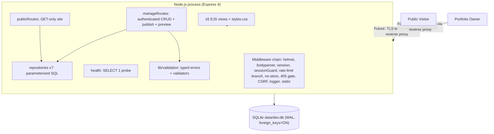

# BLUEPRINT.md

**Document ID:** SYS-BLUEPRINT-001 · **Version:** 1.0 · **Date:** 2026-10-10
**GOVERNANCE — RULES FOR EVERY FUTURE TURN**
- Read this file first; it is law.
- Never invent a file not in Section B; if new file needed, STOP, propose amendment, wait approval.
- Work ONE build step at a time from Section F; never skip ahead.
- After each step, run its test and report: files created/modified, test result, next step.
- If reality diverges, update Section J Change Log BEFORE writing code.
- Treat this as the architect's drawing: the drawing decides, the mason places one stone at a time.

---

## SECTION A: SYSTEM OVERVIEW

### One-paragraph mission statement
This is a single-user, evidence-first portfolio system for a software engineer. It lets the engineer (the only authenticated user) author professional content — profile, projects, skills, claims, and evidence references — in a private, session-protected management interface, and deliberately publish it to a GET-only public website where recruiters, hiring managers, technical interviewers, and clients can trace every claim to evidence with an honest accessibility label (Public / Private-Restricted / Redacted / Unavailable). It replaces the unverifiable resume format with a claim→evidence→artifact chain, storing references only — never artifact content. Evidence: `docs/00-SYSTEM-VISION.md:8-21`, `docs/03-REQUIREMENTS.md:14-15`, `README.md:1-3`.

### High-level architecture diagram (C4-L2 container view — as built)


### Tech stack with exact versions (pinned from package.json and lockfile)
| Component | Version | Evidence |
|---|---|---|
| Node.js | Host: v24.13.1 (roadmap `:284`); CI/Docker target: 20 LTS [I-6] | `package.json:engines` planned, `.nvmrc` STEP-004 |
| express | ^4.18.2 | `package.json:20` |
| better-sqlite3 | ^11.10.0 | `package.json:17` |
| ejs | ^3.1.10 | `package.json:18` |
| express-session | ^1.17.3 | `package.json:22` |
| express-rate-limit | ^6.7.0 | `package.json:23` |
| helmet | ^7.0.0 | `package.json:24` |
| morgan | ^1.10.0 | `package.json:25` |
| bcryptjs | ^2.4.3 | `package.json:16` |
| dotenv | ^16.6.1 | `package.json:19` |
| dev: eslint | ^9.39.5 | `package.json:26` |
| dev: @eslint/js | ^9.39.5 | `package.json:27` |
| dev: jest | ^30.5.2 | `package.json:28` |
| dev: nodemon | ^3.1.14 | `package.json:29` |
| dev: supertest | ^7.3.1 | `package.json:30` |
| planned dev: playwright | ^1.x (latest stable at install) | `package.json` devDeps STEP-013 |
| planned dev: @axe-core/playground | ^4.x (latest stable at install) | `package.json` devDeps STEP-013 |

### Layer map (Foundation / Load-bearing / Floors / Utilities / Wiring / Facade / Safety / Deployment)
| Layer | Responsibility | Owned Files/Dirs |
|---|---|---|
| Foundation | Data persistence, schema, DB connection, env contract | `src/db/schema.sql`, `src/db/migrations/`, `src/config/database.js`, `.env`, `.nvmrc` |
| Load-bearing | Core domain logic, business rules, APIs (CRUD, publish, attach) | `src/repositories/*`, `src/lib/validation.js`, `src/routes/manageRoutes.js` (write logic), `src/app.js` (app factory) |
| Floors | Feature modules / services (public views, manage groups, career-history) | `src/routes/publicRoutes.js`, `src/views/`, `src/routes/manageRoutes.js` (read logic), planned career-history files |
| Utilities | Auth, logging, config, error handling, secrets | `src/middleware/*`, `eslint.config.js` |
| Wiring/Plumbing | Integrations, external references, CI context | Evidence `file_path` (http(s) URLs only — zero outbound calls), `.github/workflows/ci.yml` |
| Facade/UI | Frontend, public interface | `public/css/styles.css`, `public/`, `src/routes/publicRoutes.js`, `src/views/*` |
| Safety systems | Tests, CI, validation, rate limits, backups | `tests/`, CI config, `docs/OPS-RUNBOOK.md`, `docs/PERFORMANCE-BASELINE.md` |
| Deployment | Deploy, scale, observe, rollback | `src/server.js`, Dockerfile, docker-compose.yml, `/health` probe, git tags |

---

## SECTION B: FOLDER & FILE TREE

```text
Portfolio/
├── BLUEPRINT.md                       [DOC]   this file — build law
├── README.md                          [DOC]   public overview + setup
├── SYSTEM_BLUEPRINT.md                [DOC]   descriptive system narrative (reference)
├── BUILD_ROADMAP.md                   [DOC]   analytic build analysis (superseded ordering → BLUEPRINT §F wins)
├── UML_DIAGRAMS.md                    [DOC]   18 UML diagrams (reference)
├── STAGE_1_RESULT.md                  [DOC]   governance stage record
├── STAGE_1_1_RESULT.md                [DOC]   governance stage record
├── STAGE_1_1_FINAL_REVIEW.md          [DOC]   governance stage record
├── STAGE_2_RESULT.md                  [DOC]   governance stage record
├── STAGE_2_1_RESULT.md                [DOC]   governance stage record
├── package.json                       [CONFIG]  deps, scripts (start/dev/test/lint), jest config
├── package-lock.json                  [CONFIG]  exact dependency tree
├── eslint.config.js                   [CONFIG]  ESLint 9 flat config for src+tests
├── .gitignore                         [CONFIG]  excludes .env, data/, node_modules, *.db*
├── .env.example                       [CONFIG]  documented env template
├── .env                               [CONFIG]  local secrets — NEVER committed
├── .nvmrc                             [CONFIG]  planned: pins Node 20 LTS     ← planned
├── .dockerignore                      [CONFIG]  planned: image build context excludes
├── Dockerfile                         [CONFIG]  planned: multi-stage production image
├── docker-compose.yml                 [CONFIG]  planned: single-service compose + volume
├── .github/
│   └── workflows/
│       └── ci.yml                     [CONFIG]  planned: lint+test+audit gate
├── docs/                              [DOC]   frozen design chain (46 files)
│   ├── 00-SYSTEM-VISION.md            vision statement and success criteria
│   ├── 01-PROBLEM-DEFINITION.md       problem analysis feeding requirements
│   ├── 02-STAKEHOLDERS.md             stakeholder needs analysis
│   ├── 03-REQUIREMENTS.md             ACCEPTED FR/NFR baseline (frozen input)
│   ├── 04-EVIDENCE-MODEL.md           claim/evidence conceptual model
│   ├── 05-DOMAIN-MODEL.md             ACCEPTED domain model
│   ├── 06-MODULE-CATALOG.md           module catalogue
│   ├── 06-SYSTEM-ARCHITECTURE.md      ACCEPTED AND FROZEN architecture
│   ├── 07-SYSTEM-ARCHITECTURE.md      stage draft retained for provenance
│   ├── 07-TECHNOLOGY-AND-IMPLEMENTATION-STRATEGY.md Stage 4.1 strategy
│   ├── 08-APPLICATION-AND-USE-CASE-DESIGN.md Stage 4.2 use-case design
│   ├── 08-DATA-ARCHITECTURE.md        stage draft retained for provenance
│   ├── 09-SECURITY-ARCHITECTURE.md    stage draft retained for provenance
│   ├── 09-DATA-AND-PERSISTENCE-DESIGN.md ACCEPTED AND FROZEN data design
│   ├── 10-INTERFACE-AND-API-DESIGN.md AUDITED, ACCEPTED AND FROZEN interfaces
│   ├── 10-QUALITY-REQUIREMENTS.md     stage draft retained for provenance
│   ├── 11-AUTHENTICATION-AND-SECURITY-DESIGN.md ACCEPTED AND FROZEN security design
│   ├── 11-VERIFICATION-STRATEGY.md    stage draft retained for provenance
│   ├── 12-TECHNOLOGY-DECISIONS.md     ACCEPTED AND FROZEN stack decisions (Stage 4.9)
│   ├── 12-UX-AND-INTERACTION-DESIGN.md UX/interaction design
│   ├── 13-IMPLEMENTATION-ROADMAP.md   stage draft retained for provenance
│   ├── 13-TESTING-DESIGN.md           ACCEPTED AND FROZEN testing design (Stage 4.7)
│   ├── 14-DECISION-LOG.md             live governance decision log
│   ├── 15-GOVERNANCE-AND-STAGE-LIFECYCLE.md stage lifecycle rules
│   ├── 16-IMPLEMENTATION-FRAMEWORK-AND-ENVIRONMENT-SETUP.md Stage 5 environment setup
│   ├── 16-SYSTEM-DISSECTION-AND-ADJUSTMENT-LEDGER.md dissection ledger ADJ-001 to ADJ-021
│   ├── 16a-MOD-004-EVIDENCE-STORE-DISSECTION.md module dossier
│   ├── 16b-MOD-001-PROFILE-DISSECTION.md module dossier
│   ├── 16c-MOD-002-PROJECT-DISSECTION.md module dossier
│   ├── 16d-MOD-003-SKILL-DISSECTION.md module dossier
│   ├── 16e-MOD-006-CONTENT-DISSECTION.md module dossier
│   ├── 16f-MOD-005-SECURITY-DISSECTION.md module dossier
│   ├── 16g-MOD-007-PUBLIC-VIEWS-DISSECTION.md module dossier
│   ├── 17-IMPLEMENTATION-AND-FEATURE-DEVELOPMENT.md feature development guide
│   ├── 18-TESTING-VERIFICATION-RELEASE.md verification and release guide
│   ├── 19-APPLICATION-IMPLEMENTATION.md application implementation guide
│   ├── ENGINEERING-CONSTITUTION.md    governing engineering principles
│   ├── ENVIRONMENT-AUDIT.md           environment audit
│   ├── STAGE_4_1_RESULT.md            stage record
│   ├── STAGE_4_11_AUDIT_REPORT.md     audit record
│   ├── STAGE_4_12_AUDIT_REPORT.md     audit record
│   ├── STAGE_4_12_AUDIT_REPORT_2.md   audit record
│   ├── STAGE_5_1_AUDIT_REPORT.md      audit record
│   ├── (planned) OPS-RUNBOOK.md       backup, restore, rotation, restart runbook
│   └── (planned) PERFORMANCE-BASELINE.md Lighthouse baseline for FR-010
├── public/
│   ├── .gitkeep                       [CONFIG]  directory marker
│   └── css/styles.css                 [UI]      responsive+accessible stylesheet
├── data/                              [FOUNDATION] SQLite dir (gitignored, runtime artifact)
│   └── dev.db
├── src/
│   ├── .gitkeep                       [CONFIG]  directory marker
│   ├── server.js                      [FOUNDATION] entry: dotenv, PORT validation, boot
│   ├── app.js                         [CORE]    app factory + middleware chain + shutdown
│   ├── config/
│   │   └── database.js                [FOUNDATION] sqlite singleton, pragma verify, WAL, schema+migrations
│   ├── db/
│   │   ├── schema.sql                 [FOUNDATION] 12 tables, 7 triggers, 5 indexes
│   │   └── migrations/
│   │       └── 001_baseline.sql       [FOUNDATION] planned: recorded baseline migration
│   ├── lib/
│   │   └── validation.js              [UTILITY] typed errors + field validators + enums
│   ├── middleware/
│   │   ├── auth.js                    [UTILITY] session lifecycle + requireAuth + bcrypt verify
│   │   ├── csrf.js                    [UTILITY] synchronizer-token CSRF
│   │   ├── rateLimiters.js            [UTILITY] 100/10 per-minute limiters
│   │   ├── noStore.js                 [UTILITY] no-store on /manage
│   │   ├── logger.js                  [UTILITY] request logging, no secrets
│   │   └── errorHandler.js            [UTILITY] typed error contract
│   ├── repositories/
│   │   ├── profileRepository.js       [CORE]    profile SQL (singleton)
│   │   ├── projectRepository.js       [CORE]    project SQL + joins
│   │   ├── skillRepository.js         [CORE]    skill SQL + joins
│   │   ├── claimRepository.js         [CORE]    claim SQL + links
│   │   ├── evidenceRepository.js      [CORE]    evidence SQL + links
│   │   ├── experienceRepository.js    [FEATURE]  planned: experience SQL
│   │   └── educationRepository.js     [FEATURE]  planned: education SQL
│   ├── routes/
│   │   ├── health.js                  [CORE]    GET /health probe
│   │   ├── publicRoutes.js            [UI]      GET-only public site
│   │   └── manageRoutes.js            [CORE]    authenticated management surface
│   └── views/
│       ├── index.ejs                  [UI]
│       ├── error.ejs                  [UI]
│       ├── partials/header.ejs        [UI]
│       ├── partials/footer.ejs        [UI]
│       ├── projects/list.ejs          [UI]
│       ├── projects/detail.ejs        [UI]
│       ├── skills/list.ejs            [UI]
│       ├── skills/detail.ejs          [UI]
│       ├── manage/login.ejs           [UI]
│       ├── manage/dashboard.ej        [UI]
│       ├── manage/profile.ejs         [UI]
│       ├── manage/projects/list.ejs   [UI]
│       ├── manage/projects/form.ejs   [UI]
│       ├── manage/skills/list.ejs     [UI]
│       ├── manage/claims/list.ejs     [UI]
│       ├── manage/evidence/list.ejs   [UI]
│       ├── manage/experience.ejs      [UI] planned
│       └── manage/education.ejs       [UI] planned
└── tests/
    ├── helpers.js                     [TEST]
    ├── health.test.js                 [TEST]
    ├── auth.test.js                   [TEST]
    ├── publication.test.js            [TEST]
    ├── content.test.js                [TEST]
    ├── constraints.test.js            [TEST]
    ├── manageEvidenceList.test.js     [TEST]
    ├── careerHistory.test.js          [TEST] planned
    ├── migrations.test.js             [TEST] planned
    └── a11y.test.js                   [TEST] planned
```

---

## SECTION C: MODULE CONTRACTS

For every module/folder in Section B, specify:

| Module | Responsibility | Public Interface | Dependencies | Data Owned vs Borrowed | Failure Modes |
|---|---|---|---|---|---|
| C0 repo toolchain config (.env.example, .nvmrc, .gitignore, eslint.config.js, package.json, package-lock.json) | Define environment, dependencies, tooling, lint rules | None (config-only) | None | Owns config files; borrows nothing | Misconfiguration → boot/lint/test failure |
| C1 server.js | Process entry: load .env, validate PORT (1–65535), call startServer | HTTP listener (port) | app.js | Owns nothing; borrows env, PORT | Invalid PORT or missing .env → boot exit with message |
| C2 app.js | Assemble middleware chain in fixed order; fail-fast config; graceful shutdown | Express app | all middleware + routes | Owns nothing; borrows middleware, routes | Middleware/route import failure → boot exit |
| C3 config/database.js | Singleton better-sqlite3 connection; verifies PRAGMA foreign_keys=ON (fails fast if not 1), enables WAL, applies schema.sql idempotently; applies migrations | Database handle | better-sqlite3 | Owns DB handle; borrows env (NODE_ENV, DB_PATH) | FK verify fail, WAL fail, schema apply fail → boot exit |
| C4 db/ (schema.sql + migrations/) | SQLite schema: 12 tables, 7 updated_at triggers, 5 indexes; migration files versioned | None (SQL DDL) | None | Owns schema.sql, migration files; borrows nothing | Syntax error → boot fail; missing migration → panic |
| C5 lib/validation.js | Typed errors (ValidationError 400, ConflictError 409, NotFoundError 404); enums; field validators | ValidationError, ConflictError, NotFoundError, enums, validator functions | None | Owns nothing; borrows nothing | Validator logic bugs → 400/409/404 incorrect |
| C6 middleware/auth.js | Session lifecycle (30m idle / 24h absolute), requireAuth (302 for GET, 401 render for POST), bcrypt verifyCredential | sessionGuard, requireAuth, verifyCredential | express-session, bcrypt | Owns session fields; borrows env hash | Session secret missing → boot fail; verifyCredential bug → auth bypass/lockout |
| C7 middleware/csrf.js | Synchronizer-token CSRF: issue per session, verify _csrf body field or x-csrf-token header on non-safe methods → 403 | csrfMiddleware | express-session | Owns nothing; borrows session | Token generation/verification bug → false 403/false pass |
| C8 middleware/rateLimiters.js | 100 req/min public, 10 req/min /manage (memory store); relaxed to 10 000 under NODE_ENV=test | publicLimiter, manageLimiter | express-rate-limit | Owns nothing; borrows env NODE_ENV | Limiter logic bug → DoS or false 429 |
| C9 middleware/noStore.js | Cache-Control: no-store + Pragma: no-cache on all /manage responses | noStorePrivate | None | Owns nothing; borrows nothing | Logic bug → accidental caching of private data |
| C10 middleware/logger.js | Request log line METHOD path -> status (ms); no query strings/credentials; 5xx to console.error; /health silenced | logger | None | Owns nothing; borrows nothing | Logic bug → lost logs or secret leak |
| C11 middleware/errorHandler.js | Central error contract: 400/401/403/404/409/500 by typed error status; HTML vs JSON by req.accepts('html'); never leaks stacks; logs only method/url/status/name/code | errorHandler | validation.js, database.js | Owns nothing; borrows validation, database | Logic bug → wrong status, leak, or infinite loop |
| C12 repositories/profileRepository.js | Profile SQL: singleton get/create/update, setPublicationState (app-level + schema guard) | getProfile, getProfileById, createProfile, updateProfile, setPublicationState | config/database.js, validation.js | Owns SQL statements; borrows DB handle, validation | Singleton bypass → dupes; FK guard missing → orphan |
| C13 repositories/projectRepository.js | Project SQL: CRUD, publish/unpublish, listClaims/listEvidence, attachEvidence/skill, delete with 409 if claims reference | listAll, listPublished, getById, create, update, setPublicationState, remove, listClaims, listEvidence, attachEvidence, listSkills, attachSkill | config/database.js, validation.js | Owns SQL statements; borrows DB handle, validation | Delete-while-claimed missing 409 → orphan claims; FK guard missing → orphan joins |
| C14 repositories/skillRepository.js | Skill SQL: CRUD, case-insensitive unique name, publish/unpublish, listClaims/listEvidence, attachEvidence, delete with 409 if claims reference | listAll, listPublished, getById, findByName, create, update, setPublicationState, remove, listClaims, listEvidence, attachEvidence | config/database.js, validation.js | Owns SQL statements; borrows DB handle, validation | Delete-while-claimed missing 409 → orphan claims; FK guard missing → orphan joins; dupe name → integrity loss |
| C15 repositories/claimRepository.js | Claim SQL: CRUD, setPublicationState, listEvidence, attachEvidence, delete cascades links only | listAll, getById, create, update, setPublicationState, remove, listEvidence, attachEvidence | config/database.js | Owns SQL statements; borrows DB handle | Delete missing link cascade → orphan links; FK guard missing → orphan evidence |
| C16 repositories/evidenceRepository.js | Evidence SQL: CRUD, setAccessibility, listClaims, delete cascades joins | listAll, getById, create, setAccessibility, remove, listClaims | config/database.js | Owns SQL statements; borrows DB handle | Delete missing join cascade → orphan joins; FK guard missing → orphan evidence |
| C17 repositories/experienceRepository.js [FEATURE] | Experience SQL: CRUD, FK profile_id ON DELETE CASCADE | listAll, getById, create, update, remove | config/database.js | Owns SQL statements; borrows DB handle, validation | FK cascade missing → orphan experience on profile delete |
| C18 repositories/educationRepository.js [FEATURE] | Education SQL: CRUD, FK profile_id ON DELETE CASCADE | listAll, getById, create, update, remove | config/database.js | Owns SQL statements; borrows DB handle, validation | FK cascade missing → orphan education on profile delete |
| C19 routes/health.js | Liveness+readiness: SELECT 1 probe | GET /health → 200 {status:OK,database:up} / 503 | config/database.js | Owns nothing; borrows DB handle | DB probe bug → false 503/false 200 |
| C20 routes/publicRoutes.js | GET-only public site: home (profile-gated), project list/detail, skill list/detail; published-only filtering; claim→evidence nesting | GET /, /projects, /projects/:id, /skills, /skills/:id | profileRepo, projectRepo, skillRepo, claimRepo | Owns nothing; borrows repos | Missing published filter → leak drafts; missing honesty label → misrep |
| C21 routes/manageRoutes.js | Authenticated management surface: login/logout, dashboard, profile, projects, skills, claims, evidence, publish/unpublish, attach-links, preview | GET/POST /manage/* (login/logout, dashboard, profile CRUD, projects CRUD, skills CRUD, claims CRUD, evidence CRUD, publish/unpub, attach, preview) | all 7 repos, validation.js, auth.js, csrf.js | Owns nothing; borrows repos, validation, auth, csrf | Missing CSRF → auth bypass; missing validation → 400/500; missing auth guard → priv leak |
| C22 views/ | 16 EJS templates rendering locals from routes | None (template files) | None (logic in routes) | Owns template files; borrows nothing | Template bug → broken UI, XSS if user-content unsafely interpolated (none found) |
| C23 public/ assets | Static assets served at root | None (static files) | None | Owns asset files; borrows nothing | Missing file → 404 |
| C24 tests/ | Supertest integration suites exercising app factory | None (test files) | app.js, helpers.js | Owns test assertions; borrows app factory | False pass/fail → undetected regression |
| C25 .github/workflows/ci.yml | CI pipeline: npm ci → lint → test → audit --omit=dev on push/PR | None (config) | None | Owns workflow file; borrows nothing | Syntax error → CI fail; missing step → weak gate |
| C26 Docker bundle (Dockerfile, .dockerignore, docker-compose.yml) | Container image build and compose service | None (config) | None | Owns config files; borrows nothing | Syntax error → build fail; missing healthcheck → undegradable |
| C27 docs/ + BLUEPRINT.md governance docs | Narrative, design, governance, runbook, baseline | None (doc files) | None | Owns doc files; borrows nothing | Missing doc → knowledge drift; incorrect doc → wrong action |

### Dependency cycles check
The dependency graph is strictly acyclic:  
server.js → app.js → {middleware, routes} → repositories → config/database.js → better-sqlite3  
middleware/auth.js, csrf.js, rateLimiters.js, noStore.js, logger.js, errorHandler.js → (no reverse)  
repositories → config/database.js, lib/validation.js  
errorHandler.js → config/database.js, lib/validation.js  
routes → repositories, lib/validation.js, middleware/auth.js, middleware/csrf.js  
views → (no outgoing deps)  
public/ → (no outgoing deps)  
tests → app.js, helpers.js  
No module imports anything that (transitively) imports it back. State verified by inspection.

---

## SECTION D: DATA MODEL

### Entities, fields, types, constraints, relationships
See `src/db/schema.sql` for canonical source. Summary:

| Table | Key Fields (type, constraint) | Notes |
|---|---|---|
| profile | id INTEGER PK, name TEXT NOT NULL, role TEXT NOT NULL, summary TEXT NOT NULL, contact_info TEXT, publication_state TEXT NOT NULL DEFAULT 'Draft' CHECK (publication_state IN ('Draft','Published','Archived')), singleton INTEGER NOT NULL DEFAULT 1 CHECK (singleton=1) UNIQUE | Hard singleton (app-level + schema) |
| project | id INTEGER PK, title TEXT NOT NULL, description TEXT, outcomes TEXT, roles TEXT, technologies TEXT, publication_state TEXT NOT NULL DEFAULT 'Draft' CHECK (publication_state IN ('Draft','Published','Archived')) | title ≤300 via route validation |
| skill | id INTEGER PK, name TEXT NOT NULL, description TEXT, publication_state TEXT NOT NULL DEFAULT 'Draft' CHECK (publication_state IN ('Draft','Published','Archived')) | name unique case-insensitive (app-level) |
| evidence | id INTEGER PK, description TEXT, file_path TEXT (must be http(s) URL if set), file_type TEXT, accessibility_status TEXT NOT NULL DEFAULT 'Public' CHECK (accessibility_status IN ('Public','Private/Restricted','Redacted','Unavailable')) | file_path validated http(s) in route |
| claim | id INTEGER PK, statement TEXT NOT NULL, justification TEXT, source_entity_type TEXT CHECK (source_entity_type IN ('profile','project','skill')), source_entity_id INTEGER, publication_state TEXT NOT NULL DEFAULT 'Draft' CHECK (publication_state IN ('Draft','Published','Archived')) | source_entity_type/id polymorphic with no SQL FK — integrity enforced in route code |
| experience | id INTEGER PK, profile_id INTEGER NOT NULL, title TEXT NOT NULL, company TEXT NOT NULL, start_date TEXT NOT NULL, end_date TEXT, description TEXT, FOREIGN KEY (profile_id) REFERENCES profile(id) ON DELETE CASCADE | FK cascade on profile delete |
| education | id INTEGER PK, profile_id INTEGER NOT NULL, institution TEXT NOT NULL, degree TEXT NOT NULL, field_of_study TEXT, start_date TEXT NOT NULL, end_date TEXT, description TEXT, FOREIGN KEY (profile_id) REFERENCES profile(id) ON DELETE CASCADE | FK cascade on profile delete |
| project_skill | project_id INTEGER NOT NULL FK, skill_id INTEGER NOT NULL FK, created_at DATETIME DEFAULT CURRENT_TIMESTAMP, PRIMARY KEY (project_id, skill_id), FOREIGN KEY (project_id) REFERENCES project(id) ON DELETE CASCADE, FOREIGN KEY (skill_id) REFERENCES skill(id) ON DELETE CASCADE | Join table, CASCADE both sides |
| project_evidence | project_id INTEGER NOT NULL FK, evidence_id INTEGER NOT NULL FK, created_at DATETIME DEFAULT CURRENT_TIMESTAMP, PRIMARY KEY (project_id, evidence_id), FOREIGN KEY (project_id) REFERENCES project(id) ON DELETE CASCADE, FOREIGN KEY (evidence_id) REFERENCES evidence(id) ON DELETE CASCADE | Join table, CASCADE both sides |
| skill_evidence | skill_id INTEGER NOT NULL FK, evidence_id INTEGER NOT NULL FK, created_at DATETIME DEFAULT CURRENT_TIMESTAMP, PRIMARY KEY (skill_id, evidence_id), FOREIGN KEY (skill_id) REFERENCES skill(id) ON DELETE CASCADE, FOREIGN KEY (evidence_id) REFERENCES evidence(id) ON DELETE CASCADE | Join table, CASCADE both sides |
| claim_evidence | claim_id INTEGER NOT NULL FK, evidence_id INTEGER NOT NULL FK, created_at DATETIME DEFAULT CURRENT_TIMESTAMP, PRIMARY KEY (claim_id, evidence_id), FOREIGN KEY (claim_id) REFERENCES claim(id) ON DELETE CASCADE, FOREIGN KEY (evidence_id) REFERENCES evidence(id) ON DELETE CASCADE | Join table, CASCADE links only (evidence survives claim delete) |

Triggers: 7 updated_at triggers (profile, project, skill, evidence, claim, experience, education) maintain updated_at = CURRENT_TIMESTAMP on UPDATE.

Indexes: idx_project_publication_state, idx_evidence_accessibility, idx_skill_publication_state, idx_claim_publication_state, idx_claim_source (source_entity_type, source_entity_id).

### Schema migrations plan
- A migration runner in `src/config/database.js` applies numbered SQL files in `src/db/migrations/` after applying `src/db/schema.sql`.
- The `_migration` table (columns: id TEXT PK, applied_at TEXT) records applied migrations to avoid re-application.
- Migration 001 (`src/db/migrations/001_baseline.sql`) is a no-op baseline that records the current schema state as applied.
- **Rule:** Never edit `src/db/schema.sql` retroactively for changes against an existing `data/dev.db`. To change schema: write a new migration file, boot, let runner apply it. For fresh installs, `schema.sql` + migrations produce identical state.

### Where data lives
- **Domain data:** SQLite file (`data/dev.db` in dev, `data/test.db` in test, or `DB_PATH` override). WAL mode, foreign keys enforced, schema applied idempotently on boot.
- **Sessions:** Express-session MemoryStore (in-process). Sessions die on process restart (accepted RISK-003).
- **Secrets:** Environment variables `SESSION_SECRET` (cookie signing) and `OWNER_BCRYPT_HASH` (bcrypt hash). Never stored in DB or logs.
- **Logs:** stdout only (request logger + morgan dev outside prod; errorHandler JSON context on 5xx). No query strings, credentials, cookies, or session IDs ever logged.

---

## SECTION E: INTERFACES & CONTRACTS

### API endpoints (method, path, auth/CSRF, success, main errors)
#### Public surface (GET-only; rate 100/min/IP; 405 on any other method — `src/app.js:88-92`)
| Method | Path | Success | Errors |
|---|---|---|---|
| GET | `/` | 200 HTML (profile-gated: if profile missing/unpublished → placeholder hero, **no project/skill lists**; else published profile + published lists) | — |
| GET | `/projects` | 200 HTML (published projects, newest-first) | — |
| GET | `/projects/:id(\d+)` | 200 HTML (if found **and** Published) → detail with published claims (each claim nests its evidence), attached evidence (with honest accessibility labels), attached skills | 404 if not found **or** not Published |
| GET | `/skills` | 200 HTML (published skills, name-ordered) | — |
| GET | `/skills/:id(\d+)` | 200 HTML (if found **and** Published) → detail with published claims + evidence | 404 if not found **or** not Published |
| GET | `/health` | 200 JSON `{status:"OK",database:"up",timestamp}` | 503 JSON (real SELECT 1 probe) |
| any non-GET outside `/manage` | — | **405 JSON** `{error:"Method Not Allowed"}` | — |
| anything unmatched | — | 404 (HTML for browsers, JSON otherwise) | — |

#### Management surface (`/manage/*`; rate 10/min/IP; all responses `no-store`; POST requires CSRF; unauth GET→302 login, unauth POST→401)
| Method | Path | Purpose | Errors |
|---|---|---|---|
| GET | `/manage/login` | Login page (public; redirects to dashboard if authed) | — |
| POST | `/manage/login` | Sign in; **session regenerate** (fixation protection); CSRF token carried across rotation; 303 → `returnTo` or `/manage` | 401 wrong password; 403 CSRF; 500 regeneration failure |
| POST | `/manage/logout` | Destroy session; 303 → `/` | — |
| GET | `/manage` | Dashboard: content counts (total/published per type) | — |
| GET/POST | `/manage/profile` | Create-or-update the singleton profile (name≤200, role≤200, summary≤5000, contact≤2000) | 400 field errors |
| POST | `/manage/profile/publish` · `/unpublish` | Published ↔ Draft | 404 if no profile |
| GET `/manage/projects`, `/manage/projects/new`; POST `/manage/projects` | List / new form / create (title≤300, description≤10000, outcomes≤5000, roles≤500, technologies≤1000) | 400 |
| GET `/manage/projects/:id/edit`; POST `/manage/projects/:id` | Edit form / update | 404 |
| POST | `/manage/projects/:id/delete` | Delete — **409 while claims reference it** | 409 |
| POST | `/manage/projects/:id/publish|unpublish` | State flips | — |
| POST | `/manage/projects/:id/evidence` · `/skills` | Attach existing evidence/skill (idempotent) | 400 invalid id |
| GET/POST | `/manage/skills`; POST `/manage/skills/:id`; `.../delete`; `.../publish|unpublish`; `.../evidence` | Skill CRUD; **case-insensitive unique name** → 400 dupe; delete 409 while claims reference | 400/404/409 |
| GET/POST | `/manage/claims`; POST `/manage/claims/:id`; `.../delete`; `.../publish|unpublish`; `.../evidence` | Claim CRUD with optional polymorphic source (type+existence validated per type); delete cascades links only | 400/404 |
| GET/POST | `/manage/evidence`; POST `/manage/evidence/:id/accessibility`; `.../delete` | Evidence reference create (needs description or http(s) `file_path`); accessibility status change (enum-guarded); delete | 400/404 |
| GET | `/manage/preview/project/:id` · `/preview/skill/:id` | Render the **public templates** with all claims (including drafts) + `preview:true` | 404 |

#### Global error contract (test-locked)
| Status | Cause | Shape |
|---|---|---|
| 400 | `ValidationError` | HTML error page w/ `fieldErrors`, or JSON `{error, fieldErrors}` |
| 401 | Unauthenticated POST (with valid CSRF) or bad login | HTML error page |
| 403 | Missing/invalid CSRF token | HTML error page, **no side effects** |
| 404 | Unknown path, non-numeric id classes, GET on POST-only manage route, unpublished public detail | HTML/JSON |
| 405 | Non-GET outside `/manage` | JSON |
| 409 | `ConflictError` (RESTRICT semantics) | HTML/JSON with explanatory message |
| 500 | Anything else | Generic message; details only in server log |

Evidence: `errorHandler.js:11-59`, `csrf.js:24-30`, `auth.js:40-52`, `app.js:88-92`; locked by `tests/auth.test.js`, `tests/manageEvidenceList.test.js:72-83`, `tests/constraints.test.js:21`.

### CLI commands
| Command | Purpose |
|---|---|
| `npm start` | Start the server |
| `npm dev` | Start with nodemon (auto-restart) |
| `npm test` | Run the Jest test suite |
| `npm run lint` | ESLint over `src` and `tests` |
| `npm run test:a11y` | Run Playwright+axe accessibility suite (planned) |

### Event/message schemas
- **None.** No message brokers, no events, no webhooks, no CLI beyond npm scripts.

### Config keys and env vars with defaults
| Var | Required | Default | Controls | Evidence |
|---|---|---|---|---|
| `SESSION_SECRET` | Yes, ≥32 chars — fail-fast at boot | — | Session cookie signing | `app.js:28-30` |
| `OWNER_BCRYPT_HASH` | Yes, present — fail-fast | — | The single management credential (bcrypt ≥12 rounds; compareSync) | `app.js:31-33`, `auth.js:55-63` |
| `PORT` | No (3000) | 3000 | Listen port; must be integer 1–65535 | `server.js:12-16` |
| `NODE_ENV` | No (development) | development | `development/test/production`: DB filename, Secure cookies, trust proxy, morgan dev, rate-limit test relaxation | `database.js:26-35`, `app.js:20,46,99`, `rateLimiters.js:7` |
| `DB_PATH` | No | (empty → data/dev.db if NODE_ENV≠test, else data/test.db) | Absolute/relative SQLite path override | `database.js:28-29` |

`.env` is loaded only if present, never committed (`.gitignore:5-6`; `server.js:6-8`). Actual `.env` exists with all five keys set (names verified only — values never read).

---

## SECTION F: BUILD ORDER (THE STONE-BY-STONE PLAN)

Numbered, topological, grouped into milestones M1–M7. Format:  
**STEP N — title | Files touched | Done when | Test**

### M1 FOUNDATION (verify existing stones)
- **STEP-001** — Environment & toolchain baseline | `package.json`, `package-lock.json`, `eslint.config.js`, `.gitignore`, `.env.example`, `.env`, `src/.gitkeep`, `public/.gitkeep` | Done when: `npm ci` succeeds from lockfile; `npm run lint` zero errors; `npm test` 6 suites 38 tests green | Test: `npm ci`; `npm run lint`; `npm test`
- **STEP-002** — Persistence foundation | `src/db/schema.sql`, `src/config/database.js`, `data/dev.db` (runtime) | Done when: connectDB verifies `PRAGMA foreign_keys=ON`, enables WAL, applies `schema.sql` idempotently; 12 tables/7 triggers present in fresh test DB | Test: `npm test -- constraints health` (singleton + FK semantics + DB probe)
- **STEP-003** — Config fail-fast contract | `src/server.js`, `src/app.js` | Done when: boot without `SESSION_SECRET` exits with actionable message; invalid `PORT` exits; valid boot prints running line; `NODE_ENV` branches verified | Test: documented boot-matrix check (see Section G) — manual script that unsets vars and checks exit codes/messages
- **STEP-004** — Runtime pin | `.nvmrc`, `README.md` | Done when: `.nvmrc` contains `20`; `README` states supported Node 20+ (host 24 verified) | Test: `node -v` major >= 20; CI uses it later in STEP-010

### M2 CORE (verify load-bearing)
- **STEP-005** — Repository contracts | `src/repositories/profileRepository.js`, `projectRepository.js`, `skillRepository.js`, `claimRepository.js`, `evidenceRepository.js`, `src/lib/validation.js` | Done when: singleton ConflictError, project/skill delete 409 while claimed, claim-delete link-cascade, evidence delete cascade all asserted | Test: `npm test -- constraints manageEvidenceList`
- **STEP-006** — Security & error contract | `src/middleware/auth.js`, `csrf.js`, `rateLimiters.js`, `noStore.js`, `logger.js`, `errorHandler.js` | Done when: ordering 302/401/403/404/409/500 + no-store + helmet + HttpOnly asserted | Test: `npm test -- auth`

### M3 FEATURES (verify floors)
- **STEP-007** — Management floors | `src/routes/manageRoutes.js`, `src/views/manage/login.ejs`, `dashboard.ejs`, `profile.ejs`, `projects/list.ejs`, `projects/form.ejs`, `skills/list.ejs`, `claims/list.ejs`, `evidence/list.ejs` | Done when: all CRUD+publish+attach flows green | Test: `npm test -- content manageEvidenceList`
- **STEP-008** — Public facade | `src/routes/publicRoutes.js`, `src/routes/health.js`, `src/views/index.ejs`, `error.ejs`, `partials/header.ejs`, `partials/footer.ejs`, `projects/list.ejs`, `projects/detail.ejs`, `skills/list.ejs`, `skills/detail.ejs`, `public/css/styles.css` | Done when: publication isolation + health probe + honest accessibility labels asserted | Test: `npm test -- publication health constraints`

### M4 WIRING (new stones)
- **STEP-009** — Version-control baseline | `.git/` (new repo), first commit of all tracked files (per Section B except `.env` and `data/`), tag `v0.1.0-baseline` | Done when: `git status --porcelain` clean; no `.env` or `data` tracked in index | Test: `git status --porcelain`; `git ls-files | grep -E "\.env$|data/"` returns nothing
- **STEP-010** — CI pipeline | `.github/workflows/ci.yml` | Done when: push triggers verify job green (`npm ci`, `npm run lint`, `npm test`, `npm audit --omit=dev`) | Test: green run on GitHub; red-on-broken-then-revert drill
- **STEP-011** — Branch protection | remote settings (main) | Done when: main requires verify job + 1 review | Test: direct push rejected
- **STEP-012** — Docs provenance sync | `README.md`, `docs/SYSTEM-ARCHITECTURE-AND-IMPLEMENTATION-ROADMAP.md`, `docs/14-DECISION-LOG.md`, `STAGE_*.md` root (read-only provenance), `SYSTEM_BLUEPRINT.md`, `BUILD_ROADMAP.md`, `UML_DIAGRAMS.md` | Done when: test counts corrected 26→38 (6 suites), ghost `GET /claims` removed from diagrams, `csurf` mentions replaced, decision-log entry appended | Test: `grep "26/26" README.md docs/SYSTEM-ARCHITECTURE-AND-IMPLEMENTATION-ROADMAP.md` returns nothing; `docs/14-DECISION-LOG.md` contains new entry

### M5 FACADE QUALITY (a11y & perf)
- **STEP-013** — A11y toolchain + suite | `package.json` (devDeps: playwright, @axe-core/playground; script `test:a11y`), `tests/a11y.test.js` | Done when: suite boots app (helpers pattern), seeds published content, crawls P0 pages (`/`, `/projects`, `/projects/:id`, `/skills`, `/skills/:id`, `/manage/login`, 404) | Test: `npm run test:a11y`
- **STEP-014** — Fix violations | `src/views/**` (as flagged), `public/css/styles.css` | Done when: axe reports 0 violations WCAG2.2 AA on the 7 P0 pages above | Test: `npm run test:a11y` green; `npm test` still 100%
- **STEP-015** — Performance baseline | `docs/PERFORMANCE-BASELINE.md` | Done when: Lighthouse numbers recorded for P0 pages, dated | Test: file contains dated scores; no regression gate yet (FR-010 deferral documented)

### M6 HARDENING (safety systems)
- **STEP-016** — Migration runner | `src/config/database.js` (applyMigrations), `tests/migrations.test.js` | Done when: `_migration` table exists, migrations apply inside transactions, second boot no-op | Test: `npm test -- migrations`
- **STEP-017** — Baseline migration | `src/db/migrations/001_baseline.sql` | Done when: fresh DB and legacy `data/dev.db` converge; migration 001 recorded | Test: `npm test -- migrations`
- **STEP-018** — Experience repository | `src/repositories/experienceRepository.js`, `tests/careerHistory.test.js` | Done when: CRUD + FK cascade to profile asserted | Test: `npm test -- careerHistory`
- **STEP-019** — Education repository | `src/repositories/educationRepository.js`, `tests/careerHistory.test.js` | Done when: same | Test: `npm test -- careerHistory`
- **STEP-020** — Career-history routes + views | `src/routes/manageRoutes.js`, `src/views/manage/experience.ejs`, `src/views/manage/education.ejs` | Done when: CRUD behind `requireAuth`+CSRF, validation re-render, 404s, dashboard counts include new types | Test: `npm test -- careerHistory`; full `npm test` green
- **STEP-021** — Ops runbook + backup drill | `docs/OPS-RUNBOOK.md` | Done when: backup (WAL checkpoint + file copy), restore, secret rotation, restart semantics documented; drill executed | Test: runbook commands executed into temp dir; row counts match pre/post

### M7 DEPLOY (elevators/doors)
- **STEP-022** — Container image | `Dockerfile`, `.dockerignore` | Done when: image builds; runs as non-root; healthcheck present | Test: `docker build -t portfolio:v0.2.0 .` + `docker run` smoke (health 200)
- **STEP-023** — Compose + volume | `docker-compose.yml` | Done when: `docker compose up` serves `/health` 200 with volume DB; data survives `down`/`up` | Test: `curl http://localhost:3000/health`; create content via manage; `docker compose down`; `docker compose up`; verify row persists
- **STEP-024** — Archived-state decision | `docs/14-DECISION-LOG.md` | Done when: decision entry recorded (recommended default: keep enum, no route, document) | Test: `grep -n Archived src/db/schema.sql src/lib/validation.js` shows only those two files; no route sets it
- **STEP-025** — Release + optional go-live | `git tag v0.2.0`; deployment to host per I-1 | Done when: tag pushed; if deployed: live `/health` 200 over HTTPS (requires TLS termination) | Test: `git tag -l v0.2.0`; if deployed: `curl -k https://<host>/health` 200
- **STEP-026** — Blueprint reconciliation | `BLUEPRINT.md` (Section J rows), status updates | Done when: every step recorded complete; CI green on final commit | Test: CI green on final commit; Section J up-to-date

---

## SECTION G: TESTING STRATEGY

### Unit / integration / e2e / load / security tests per layer
| Layer | Test Type | Details |
|---|---|---|
| Validation lib (`src/lib/validation.js`) | Unit | Direct calls to validators, typed errors, enums (`content.test.js` covers via routes) |
| Middleware (`src/middleware/*`) | Integration | Exercise via supertest; auth/ordering (`auth.test.js`), logging console paths (manual), errorHandler status mapping (`errorHandler.js` via `auth`/`manageEvidenceList`/`constraints`) |
| Repositories (`src/repositories/*`) | Integration | SQL correctness via `constraints.test.js` (singleton, FK cascades, 409s, link cascades) and `manageEvidenceList.test.js` (listing, 401/404) |
| Routes (`src/routes/*`) | Integration | Public behavior (`publication.test.js`), manage behavior (`content.test.js`, `manageEvidenceList.test.js`), health (`health.test.js`) |
| Views (`src/views/*`) | Integration | Rendering correctness via public/manage suites; honesty labels via `constraints.test.js`; a11y via planned `tests/a11y.test.js` |
| Career-history (planned) | Integration | `tests/careerHistory.test.js` covers CRUD, FK cascade, validation, dashboard counts |
| Migrations runner (planned) | Integration | `tests/migrations.test.js` checks _migration table, apply-once, no-op second boot |
| A11y suite (planned) | End-to-end (browser) | `tests/a11y.test.js` uses Playwright to boot app (helpers pattern) and axe-core to crawl P0 pages for WCAG 2.2 AA |
| Load / performance | Deferred | Lighthouse baseline in `docs/PERFORMANCE-BASELINE.md` (FR-010 targets deliberately deferred); no load generator |
| Security | Integration + audit | `npm audit --omit=dev` (0 vulns on prod deps — roadmap `:479`); header/CSRF/rate-limit tests in `auth.test.js`; param SQL → no injection |

### What "done" means for each step (definition of done)
See Section F "Done when" columns — each step’s completion criteria are explicit and verifiable.

### Coverage targets and quality gates
- **Unit/integration:** All test suites must pass (green). No coverage tool configured; gate = 100% of written tests pass (i.e., no red suites).
- **Lint:** `npm run lint` must emit zero errors.
- **Security audit:** `npm audit --omit=dev` must show 0 vulnerabilities on production dependencies (dev-only vulns documented and accepted).
- **Performance:** No gate yet (FR-010 deferral); baseline recorded in `docs/PERFORMANCE-BASELINE.md`.
- **Accessibility:** Gate = 0 violations WCAG 2.2 AA on P0 pages (`/`, `/projects`, `/projects/:id`, `/skills`, `/skills/:id`, `/manage/login`, `404`).
- **Blueprint itself:** No change to Section F without CI green on final commit (STEP-026).

---

## SECTION H: SAFETY & OPERATIONS

### Logging, metrics, tracing, alerts
- **Logging:** stdout only. Request logger (`logger.js`) logs `METHOD path -> status (ms)` (no query strings/credentials); morgan `dev` outside production; errorHandler logs JSON context `{method,url,status,name,code}` on 5xx (plus DB error code separately). No secrets ever logged.
- **Metrics:** none [GAP — intentional for MVP].
- **Tracing:** none [GAP — intentional for MVP].
- **Alerts:** none [GAP — intentional for MVP]; health check (`/health`) suitable for external uptime monitoring.

### Auth, authz, secrets, rate limiting, input validation
- **AuthN:** Single owner credential; bcrypt hash stored in `OWNER_BCRYPT_HASH` env; constant-time `bcrypt.compareSync`; login POST → 401 on wrong password; on success `session.regenerate` (fixation protection) with CSRF token rebound to fresh session, then 303 to safe `returnTo` (only paths starting `/manage` accepted).
- **AuthZ:** Two zones: public read-only (GET only, published rows only) and owner (everything under `/manage`). No roles beyond this.
- **Secrets:** `SESSION_SECRET` (cookie signing) and `OWNER_BCRYPT_HASH` (bcrypt hash) in `.env` (gitignored); never logged; fail-fast validation at boot (`src/app.js:28-33`).
- **Rate limiting:** 100/min public, 10/min `/manage` (memory store); relaxed to 10 000 under `NODE_ENV=test`; doubles as brute-force throttle on login path.
- **Input validation:** All repository calls use parameterized statements (no SQL injection). Route validators: `requireText`, `optionalText`, `requireEnum`, `optionalInt`, `isHttpUrl` (enforce length, charset, http(s) shape). Errors → 400 with `fieldErrors` (HTML) or JSON.

### Backup, rollback, disaster recovery
- **Backup:** Run `docs/OPS-RUNBOOK.md` — WAL checkpoint (`sqlite3 data/dev.db ".backup"`) + file copy of `data/dev.db`, `data/db-shm`, `data/db-wal`.
- **Rollback:** Redeploy previous git tag + Docker image; DB file restored from backup (see runbook).
- **Disaster recovery:** Single-file DB restore from backup; if `data/dev.db` lost, recreate from backup and reapply schema/migrations (idempotent).

### CI/CD pipeline stages
1. **Verify:** `npm ci` → `npm run lint` → `npm test` → `npm audit --omit=dev` (on every push/PR).
2. **Build:** Docker image build (`Dockerfile`).
3. **Smoke:** `docker run` healthcheck (`/health` → 200).
4. **Deploy:** Manual approval → `docker compose up` (volume-persisted DB).
No automated promotion to prod without human approval (per governance).

---

## SECTION I: OPEN QUESTIONS

Each includes recommended default.

| ID | Question | Recommended Default |
|---|---|---|
| I-0 | The `>>> DESCRIBE YOUR SYSTEM HERE <<<` slot in the prompt arrived empty. What system to build? | Resolved from environment: this repo *is* the system (Software Engineer Portfolio System). Verified codebase, 38/38 tests, frozen docs. Blueprint treats already-laid stones as inspect-gets and missing stones as actual build. |
| I-1 | Deployment host/TLS decision (required for go-live in STEP-025)? | Docker Compose on single Linux host behind reverse proxy w/ TLS (e.g., Nginx or Caddy). Not authorized yet — wait for explicit go-ahead. |
| I-2 | `Archived` publication state: keep enum and no route, or implement route? | Keep enum, no route, document. Implementing route adds complexity for no current need; defer until evidence justifies. |
| I-3 | CV/Resume generation (FR-007, P1-deferred): when to implement? | Defer past v0.2.0; treat as future module after v0.2.0 release. |
| I-4 | Coverage % gate for Jest (advisory initially)? | Advisory 80% lines via `jest --coverage`; non-blocking initially. Harden later if needed. |
| I-5 | Timeline/team size assumptions? | Solo developer; milestone-driven; first-48-hours checklist (Section F) applies. |
| I-6 | Node version pin for CI/Docker? Host runs v24.13.1, but better-sqlite3 prebuilds exist for 20/22/24. | Pin CI/Docker to Node 20 LTS (`.nvmrc`=`20`, Docker base `node:20-slim`); host v24 tolerated (tests pass). |
| I-7 | Horizontal scaling / session store persistence? | Keep MemoryStore (single-instance) until multi-instance is required; then migrate to Redis or similar. Document RISK-003. |

---

## SECTION J: CHANGE LOG

| date | section | change | reason |
|---|---|---|---|
| 2026-10-10 | ALL | Initial blueprint | Verified baseline (38/38 tests, lint clean, live boot); supersedes BUILD_ROADMAP.md ordering; incorporates governance rules |
