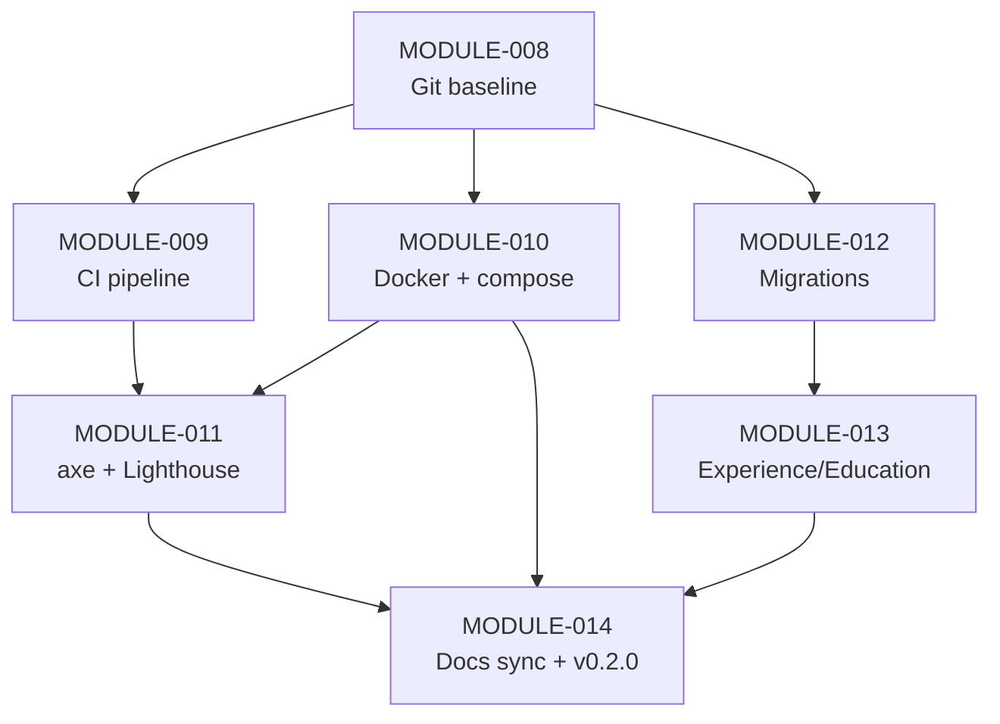

# BUILD_ROADMAP.md

**Document ID:** SYS-BUILD-001 · **Version:** 1.0 · **Date:** 2026-10-10
**Read with:** `SYSTEM_BLUEPRINT.md` (SYS-BLUEPRINT-001). All module IDs below continue the existing catalog (`MOD-001..007` are DONE and test-locked — do not rebuild them).
**SUPERSEDED ORDERING NOTICE (2026-10-10):** `BLUEPRINT.md` is now the single source of truth for build order and file inventory. Where Section F of that file conflicts with the milestones below, BLUEPRINT wins. The analysis below remains valid as background.
---

## 3.1 CRITICAL PATH ANALYSIS

**The application vertical slice already exists and is proven.** The slice *input → logic → storage → output* is:
`POST /manage/login (CSRF+bcrypt) → POST /manage/projects (validated, Draft row in SQLite) → POST /manage/projects/:id/publish (state flip) → GET /projects (Published filter → rendered HTML)`.
It is locked by `tests/publication.test.js:12-51` and verified live on 2026-10-10 (38/38 tests, health 200, 405 contract). **Do not start by "building the app" — it is built.**

The **smallest unproven end-to-end slice** — and therefore the critical path — is the **release slice**:

> **commit → CI runs lint+tests+audit on every push → container image boots with `.env` injected → `/health` returns 200 from the container.**

Why this slice first (in order of leverage):
1. **The roadmap itself names it as the immediate action** — "Initialize the Git repository and make the first commit of the verified baseline, OR begin the INC-010 pass" (`docs/SYSTEM-ARCHITECTURE-AND-IMPLEMENTATION-ROADMAP.md:490`); the change-control regime *requires* version control ("all changes to main require pull requests", `:462`).
2. **Everything else compounds on it:** CI protects the 38-test baseline from regression; Docker makes the accessibility/performance pass (INC-010) reproducible; deployment makes FR-007 work shippable.
3. **Highest loop risk lives here:** without git, every experiment is untracked and every frozen-doc governance rule is unenforceable — the classic loop the anti-loop protocol (§3.4) addresses.
4. It is the only gap that blocks *demonstrating* the system to its stated audience ("deployed portfolio meets accessibility and performance standards", `docs/00-SYSTEM-VISION.md:21`).

---

## 3.2 MODULE DISSECTION (build order)

### MODULE-008 | Version-Control Baseline
- **Purpose:** Put the verified baseline under git; establish the branch/PR regime the frozen governance already mandates.
- **Depends on:** nothing. **Unblocks:** MODULE-009, 010, 011, 012.
- **Inputs/Outputs:** working tree → local git history. **Data owned:** `.git/`.
- **Interface contract:** none code-facing; commit convention `type(scope): summary` (e.g. `chore(release): verified baseline 38/38`).
- **Implementation steps:**
  1. `git init` (produces default branch, e.g. `main`).
  2. Verify `.gitignore` coverage before staging: `.env`, `data/`, `node_modules/`, `*.db*` are all listed (`​.gitignore:2-34`) — stage nothing else.
  3. `git add .` then inspect `git status`: **must not** contain `.env` or `data/dev.db`.
  4. Commit baseline with a message citing verification evidence (38/38 tests, lint clean, live boot 2026-10-10).
  5. Tag `v0.1.0-baseline`.
- **Test plan:** `git status --porcelain` clean after commit; `git log -1` shows baseline; grep staged tree for `SESSION_SECRET=` (must be absent).
- **Definition of Done:** repo exists, history has the verified baseline, secrets provably not tracked.
- **Complexity S · Risk Low.**

### MODULE-009 | CI Pipeline (GitHub Actions)
- **Purpose:** Machine-enforce the verification contract on every push/PR.
- **Depends on:** MODULE-008 (+ hosted remote). **Unblocks:** PR workflow, MODULE-011/012 confidence.
- **Inputs/Outputs:** push/PR event → green/red check. **Data owned:** `.github/workflows/ci.yml`.
- **Interface contract:** workflow must run `npm ci`, `npm run lint`, `npm test`, `npm audit --omit=dev` on Node 20 (LTS) and cache npm. Fail the job on any non-zero exit. (better-sqlite3 needs prebuilt binaries — Node LTS on ubuntu-latest provides them.)
- **Implementation steps:**
  1. Create `.github/workflows/ci.yml` with a single `verify` job (checkout → setup-node 20 + npm cache → `npm ci` → `npm run lint` → `npm test` → `npm audit --omit=dev --audit-level=high`).
  2. Note: `npm test` needs **no env vars** — `tests/helpers.js:14-19` generates `SESSION_SECRET`/`OWNER_BCRYPT_HASH`/`DB_PATH` per run. CI stays secret-free by design.
  3. Add branch protection on `main`: require the `verify` check + 1 review (mirrors frozen change control, roadmap `:462-466`).
- **Test plan:** open a PR that intentionally breaks a test → CI red; revert → green.
- **Definition of Done:** every push gets a green run of all four steps.
- **Complexity S · Risk Low.**

### MODULE-010 | Containerized Deployment
- **Purpose:** Produce the deployable artifact promised in scope (Docker) and run the system identically anywhere.
- **Depends on:** MODULE-008 (image build context), logically MODULE-009 (image build in CI later). **Unblocks:** real deployment (G-9), INC-010 browser pass environment.
- **Inputs/Outputs:** repo → image; env (`SESSION_SECRET`, `OWNER_BCRYPT_HASH`, `PORT`, `NODE_ENV=production`, optional `DB_PATH`) → running container.
- **Interface contract (exact):**
  - Multi-stage `Dockerfile`: `node:20-slim` build stage (`npm ci --omit=dev`) → runtime stage copying `node_modules`, `src`, `public`, `package.json`; non-root `USER node`; `ENV NODE_ENV=production`; `EXPOSE 3000`; `HEALTHCHECK CMD node -e "fetch('http://localhost:3000/health').then(r=>process.exit(r.ok?0:1)).catch(()=>process.exit(1))"`.
  - **DB path must be a mounted volume** (e.g. `DB_PATH=/data/portfolio.db`) — otherwise content dies with the container. Wire `docker-compose.yml` with `./data:/data` and `env_file: .env`.
  - `.dockerignore`: `node_modules`, `data`, `.git`, `.env`, `tests`, `docs`, `coverage`.
- **Implementation steps:**
  1. Write `Dockerfile` + `.dockerignore` + `docker-compose.yml`.
  2. `docker compose up` → container boots, applies schema to `/data/portfolio.db`.
  3. curl `/health` → 200 `database:up`.
  4. Login against the container with a hash generated per README §Setup.
  5. Restart container → data persists (volume), sessions reset (MemoryStore — documented behavior).
- **Test plan:** image boots; healthcheck passes; unauthenticated `/manage` POST → 403; data survives `docker compose down && up`.
- **Definition of Done:** `docker compose up && curl /health` is the demo; volume persistence proven.
- **Complexity M · Risk Medium** (production cookie `Secure` requires TLS — deploy behind a reverse proxy or accept first-release HTTP for internal demos; decision logged per governance).

### MODULE-011 | Accessibility & Performance Verification (INC-010 completion)
- **Purpose:** Close the last open increment: automated WCAG sweep + performance baseline.
- **Depends on:** MODULE-010 (browser-capable environment) — or can run locally against `npm start`. **Unblocks:** FR-009 evidence, FR-010 baseline.
- **Inputs/Outputs:** running app → axe-core report (0 violations target), Lighthouse report (recorded baseline).
- **Interface contract:** `npm run test:a11y` (new script) spinning the app via supertest-equivalent or Playwright; violations list must be empty for P0 pages (`/`, `/projects`, `/projects/:id`, `/skills`, `/skills/:id`, error pages, login).
- **Implementation steps:**
  1. Add Playwright + `@axe-core/playwright` (dev-only).
  2. Script: boot app in test env (reuse `tests/helpers.js` pattern), seed a published profile/project/skill/claim/evidence, crawl the P0 pages, run axe against WCAG 2.2 AA ruleset.
  3. Fix any violations found (the CSS already implements focus-visible, 44 px targets, reduced-motion, contrast — `docs/16-SYSTEM-DISSECTION-AND-ADJUSTMENT-LEDGER.md:102-104`; expect a short tail).
  4. Record Lighthouse scores in `docs/` as the FR-010 baseline (targets were explicitly deferred, `docs/03-REQUIREMENTS.md:215`).
- **Test plan:** the new suite is the test plan; wire into CI as a separate non-blocking job first, blocking after green.
- **Definition of Done:** axe: 0 violations on all P0 pages; Lighthouse baseline recorded in docs; CI green including the a11y job.
- **Complexity M · Risk Medium** (axe findings can require template edits).

### MODULE-012 | Schema Migration Framework (prerequisite for any schema change)
- **Purpose:** Make schema evolution possible against existing `data/dev.db` (idempotent `CREATE IF NOT EXISTS` cannot add columns).
- **Depends on:** MODULE-008. **Unblocks:** MODULE-013 and any future schema work.
- **Inputs/Outputs:** `src/db/migrations/NNN_name.sql` files → applied-migrations table (`_migration(id TEXT PK, applied_at)`).
- **Interface contract:** `database.js` gains `applyMigrations(db)` executed after `applySchema(db)`; each migration runs once inside a transaction; migration 001 records the current baseline state.
- **Implementation steps:** create runner (≈30 lines) → add `_migration` table → backfill 001 → test: fresh DB and pre-existing dev.db both converge.
- **Test plan:** unit test running runner twice (second is no-op); integration test adding a throwaway column.
- **Definition of Done:** schema change = add file, no manual SQL against dev.db.
- **Complexity S · Risk Low.**

### MODULE-013 | Experience & Education Management (FR-007 foundation)
- **Purpose:** Surface the existing-but-orphaned `experience`/`education` tables; first step toward the P1 CV feature.
- **Depends on:** MODULE-012 (may need small schema tweaks), MODULE-011. **Unblocks:** FR-007 CV generation (future).
- **Inputs/Outputs:** manage forms → rows keyed by the singleton profile.
- **Interface contract (mirror existing patterns exactly):**
  - `src/repositories/experienceRepository.js`: `listAll()`, `getById`, `create({profile_id,title,company,start_date,end_date,description})`, `update`, `remove` — same whitelisted-column style as `projectRepository.js:32-47`.
  - Routes: `GET/POST /manage/experience`, `POST /manage/experience/:id`, `.../delete` in `manageRoutes.js` (validation via `requireText/optionalText`, dates as `TEXT` per `schema.sql:63-64`).
  - View `manage/experience.ejs` cloned from `manage/skills/list.ejs` structure; dashboard gains counts.
- **Implementation steps:** repo → routes (behind existing `requireAuth` line, `manageRoutes.js:52`) → view + nav link → CSRF-carrying forms → tests.
- **Test plan:** content-style suite: create/edit/delete with validation 400s, 404 unknown id, 401 unauth, 403 CSRF.
- **Definition of Done:** owner can add an education/experience row and see it on `/manage` (public CV rendering remains a separate future module).
- **Complexity M · Risk Low.**

### MODULE-014 | Documentation Drift Repair + Release
- **Purpose:** Reconcile docs with verified reality (§8.3 of blueprint) and cut the first tagged release.
- **Depends on:** MODULE-009/010/011. **Unblocks:** trustworthy governance going forward.
- **Interface contract:** doc-only changes recorded in `docs/14-DECISION-LOG.md` per the frozen change process (`roadmap:452-468`).
- **Implementation steps:**
  1. Roadmap: catalogue statuses MOD-002..007 → TESTS PASSING; replace test count 26→38; remove ghost `GET /claims` from the context diagram; replace `csurf` mentions with the implemented synchronizer-token design.
  2. README: test count 26→38.
  3. Record an `Archived`-state decision (implement the action or strike the value) — G-8.
  4. Tag `v0.2.0`.
- **Test plan:** none (docs); CI re-run as evidence.
- **Definition of Done:** every numeric claim in docs matches a re-run command output.
- **Complexity S · Risk Low.**

### 3.2.1 Build-order DAG



Parallel lanes: M009 and M010 can proceed simultaneously after M008; M012 and (later) M013 run off the critical path.

---

## 3.3 MILESTONE PLAN

| Milestone | Deliverables | Exit criteria (all must be re-runnable) | Demoable artifact |
|---|---|---|---|
| **M0 — Skeleton + CI + local run** | Git repo, baseline commit + tag, `.github/workflows/ci.yml` green, branch protection | `git log` shows baseline; CI job green on push; `npm test` 38/38 locally | Public repo URL with green check |
| **M1 — Release slice end-to-end** | `Dockerfile`, `.dockerignore`, `docker-compose.yml`, volume-persisted DB | `docker compose up` → `/health` 200 `database:up`; login works against container; data survives restart | One-command local deployment |
| **M2 — Quality verification pass** | Playwright+axe suite, fixes applied, Lighthouse baseline doc | axe 0 violations on P0 pages; a11y job green in CI; baseline recorded | Accessibility report in `docs/` |
| **M3 — Content completeness** | Migrations runner + Experience/Education manage module with tests | Migration runner converges fresh and legacy DBs; new suite green; dashboard counts include new types | Owner manages career history without code changes (NFR-002) |
| **M4 — Hardening & release** | Docs drift fixed, decision-log entries, tag `v0.2.0`, (optional) public deploy behind TLS per G-9 | All docs match re-run evidence; release tagged; deploy runbook (backup of `data/*.db*`, restore, env rotation) exists | Deployed public portfolio URL |
| **Final — continuous** | FR-007 CV generation (render profile+experience+education to printable HTML/PDF) as the next P1 module | CV reflects live data (FR-007 acceptance, `docs/03-REQUIREMENTS.md:158-163`) | Downloadable CV |

---

## 3.4 ANTI-LOOP PROTOCOL

Top 5 loop-generators observed in this environment, with concrete unblocks:

1. **Doc-code drift loop.** The roadmap's own numbers are stale (38/38 vs actual 38/38; catalogue "NOT STARTED" vs dashboard "TESTS PASSING"; ghost `GET /claims` route). *Symptom:* planning against roadmap text, re-discovering the code is ahead. **Unblock:** never trust a status claim in `docs/` — re-derive with `npm test`, `npm run lint`, and a file read before acting; then apply MODULE-014 so the drift cannot recur.
2. **Governance-authorization loop.** Frozen docs demand decision-log entries and forbid contradicting frozen design (`roadmap:462-467`); the roadmap's own last line withholds git init "requires your explicit go-ahead" (`:490`). This can deadlock indefinitely. **Unblock:** *you* are the authority — for each new module, append one decision-log entry (date/decision/rationale/alternatives/impact) **before** coding; treat MODULE-008 as pre-authorized by this document.
3. **Schema-change loop.** `schema.sql` is idempotent-apply only; editing it against an existing `data/dev.db` silently does nothing, making changes appear "broken". **Unblock:** no schema edit without MODULE-012's migration runner; for local experiments either delete `data/dev.db` (it is regenerated) or write a migration.
4. **Test-environment coupling loop.** Every test file must call `configureTestEnv()` **before** `require('../src/app')` (`tests/helpers.js:14-19`), and rate limits only relax under `NODE_ENV=test` (`rateLimiters.js:7`). New tests written without this hit CSRF/rate-limit failures that look like app bugs. **Unblock:** copy the header block of `tests/manageEvidenceList.test.js:1-9` verbatim into every new suite.
5. **Config-fail-fast loop.** Boot exits immediately without `SESSION_SECRET`/`OWNER_BCRYPT_HASH` (`app.js:26-37`) — moving between machines/environments produces "server won't start" loops. **Unblock:** always `Copy-Item .env.example .env` first; the error messages are actionable; generate secrets exactly as `.env.example:5,20` instructs.

---

## 3.5 FIRST 48 HOURS (literal checklist)

### Day 1 — Version control + CI (MODULE-008, 009)

**Hour 1 — Baseline the repo**
```powershell
cd G:\Futuristic_Engineering\Portfolio
git init
git status --porcelain          # confirm .env, data/, node_modules are NOT listed
npm test                        # expect: 6 suites, 38 passed
npm run lint                    # expect: no output (clean)
```
**Hour 2 — First commit**
```powershell
git add .
git status                      # verify again: no .env, no data/dev.db
git commit -m "chore(release): verified baseline - 38/38 tests, lint clean, live boot 2026-10-10"
git tag v0.1.0-baseline
```
**Hour 3 — Docs decision entry** (pre-authorizes the release track)
- Append to `docs/14-DECISION-LOG.md`: date 2026-10-10; decision "Proceed with release track (CI, Docker, a11y verification) per SYS-BUILD-001"; rationale/alternatives/impact one-liners.

**Hour 4 — Create CI workflow**
- Create `.github/workflows/ci.yml`:
```yaml
name: ci
on: [push, pull_request]
jobs:
  verify:
    runs-on: ubuntu-latest
    steps:
      - uses: actions/checkout@v4
      - uses: actions/setup-node@v4
        with: { node-version: 20, cache: npm }
      - run: npm ci
      - run: npm run lint
      - run: npm test
      - run: npm audit --omit=dev --audit-level=high
```
- Sanity-locally: `npm audit --omit=dev` (expect: 0 vulnerabilities, per roadmap `:479`).

**Hour 5 — Push + watch CI**
```powershell
# create empty GitHub repo, then:
git remote add origin <URL>
git push -u origin main
```
- Open the Actions tab → `verify` must be green. If red: fix lint/test output locally first, commit, re-push.
- Enable branch protection: require `verify`, 1 review.

**Hours 6–8 — Buffer / first PR drill**
- Branch `docs/test-count-sync`, edit `README.md:8` "38/38" → "38/38", open PR, merge when green. (Partial MODULE-014; proves the PR regime.)

### Day 2 — Container (MODULE-010)

**Hour 9–10 — Dockerfile + dockerignore**
- Create `.dockerignore`: `node_modules`, `data`, `.git`, `.env`, `tests`, `docs`, `coverage`.
- Create `Dockerfile`:
```dockerfile
FROM node:20-slim AS build
WORKDIR /app
COPY package.json package-lock.json ./
RUN npm ci --omit=dev
FROM node:20-slim
WORKDIR /app
ENV NODE_ENV=production PORT=3000 DB_PATH=/data/portfolio.db
COPY --from=build /app/node_modules ./node_modules
COPY package.json package-lock.json ./
COPY src ./src
COPY public ./public
USER node
EXPOSE 3000
HEALTHCHECK --interval=30s --timeout=5s --start-period=10s \
  CMD node -e "fetch('http://localhost:3000/health').then(r=>process.exit(r.ok?0:1)).catch(()=>process.exit(1))"
CMD ["node","src/server.js"]
```
- Create `docker-compose.yml`:
```yaml
services:
  portfolio:
    build: .
    ports: ["3000:3000"]
    env_file: .env
    volumes: ["./data:/data"]
```

**Hour 11–12 — Boot + verify**
```powershell
docker compose up --build -d
curl http://localhost:3000/health          # expect {"status":"OK","database":"up",...}
docker compose logs portfolio              # expect "Server is running on port 3000 (production)"
```
- Verify auth: generate a hash (`node -e "const b=require('bcryptjs');console.log(b.hashSync('YOUR-PASSWORD',12))"`), put it in `.env` as `OWNER_BCRYPT_HASH`, `docker compose up -d --force-recreate`, sign in at `http://localhost:3000/manage`.

**Hour 13 — Persistence proof**
```powershell
# create a project via /manage, then:
docker compose down && docker compose up -d
# sign in again: the project row still exists  (volume proves G-4-style persistence)
```

**Hour 14 — Commit the release slice**
```powershell
git add .github Dockerfile .dockerignore docker-compose.yml
git commit -m "feat(release): CI pipeline and containerized deployment with health check"
git push
```

**Hours 15–16 — M0/M1 exit review**
- Tick M0 and M1 exit criteria (§3.3). Anything red: fix before starting MODULE-011.

**Hour 17 — Start MODULE-011 (a11y)**
```powershell
npm i -D playwright @axe-core/playwright
# scaffold tests/a11y.test.js following the header of tests/manageEvidenceList.test.js
```

**Hour 18 — Retire for the day with CI green and the release slice demoable.**

*(Hours 19–48 continue MODULE-011 → MODULE-012 → MODULE-013 per §3.2 DAG; each ends with: tests green, lint clean, one commit, one decision-log entry.)*

---

## 5. ENGINEERING CHECKLIST (Phase 5)

**Code standards & linting**
- [x] ESLint 9 flat config enforced on `src` + `tests` (`eslint.config.js`); `npm run lint` green
- [ ] Add Prettier check to CI (roadmap Verification level 2 expects it, `roadmap:408`)
- [ ] Pin Node via `engines` in `package.json` (G-10)

**Branching & PR conventions**
- [x] Change control defined in frozen docs (`roadmap:462-466`)
- [ ] Branch protection live after MODULE-009; `type(scope): summary` commits

**Testing pyramid strategy**
- [x] 38 integration tests via supertest (the current pyramid is nearly all integration — appropriate for this size)
- [ ] Add the axe/Playwright layer (MODULE-011)
- [ ] Keep the "no test marked passing unless executed" rule (`roadmap:418`)

**CI/CD pipeline stages**
- [ ] ci.yml: `npm ci → lint → test → audit --omit=dev` (MODULE-009)
- [ ] Add image build + smoke test as a later stage (MODULE-010 integration)

**Environment parity**
- [x] `NODE_ENV`-driven behavior (DB file, cookies, rate limits) documented
- [ ] Container = production parity target (MODULE-010); TLS decision (G-9)

**Config & secret management**
- [x] `.env.example` complete; `.env` gitignored; fail-fast validation (`app.js:26-37`)
- [x] Secrets never logged (`logger.js`, `errorHandler.js:14-26`)
- [ ] Rotation runbook (regenerate `SESSION_SECRET`/`OWNER_BCRYPT_HASH`, redeploy)

**Logging / metrics / tracing standards**
- [x] Request log lines, no query strings/credentials; 5xx with context
- [ ] Decide structured (JSON) logging if deploying publicly (G-5); metrics/traces remain out of scope

**Error handling & retry policies**
- [x] Typed error contract 400/401/403/404/405/409/500 (`errorHandler.js`)
- [x] FK violations → 409 mapping (repositories); no retries needed (sync local DB)

**Versioning (API + data)**
- [x] HTML-form app — no API versioning surface; git tags for releases
- [ ] Data: migrations framework before first schema change (MODULE-012)

**Migration strategy**
- [ ] Migration runner + `_migration` table; never hand-edit `data/dev.db` (§3.4 item 3)

**Rollback strategy**
- [x] Deploy rollback = previous image tag (once MODULE-010 lands)
- [ ] Data rollback = restore `data/*.db*` from backup; add backup runbook (G-11)

**Documentation standards**
- [x] Frozen doc chain + decision log + governance exist
- [ ] Apply MODULE-014 to remove drift; keep decision log updated per change

**Definition of Done (global)**
- [ ] A change is Done when: `npm test` green · `npm run lint` clean · decision-log entry exists · docs touched if behavior/claims changed · committed on a PR with green CI.
