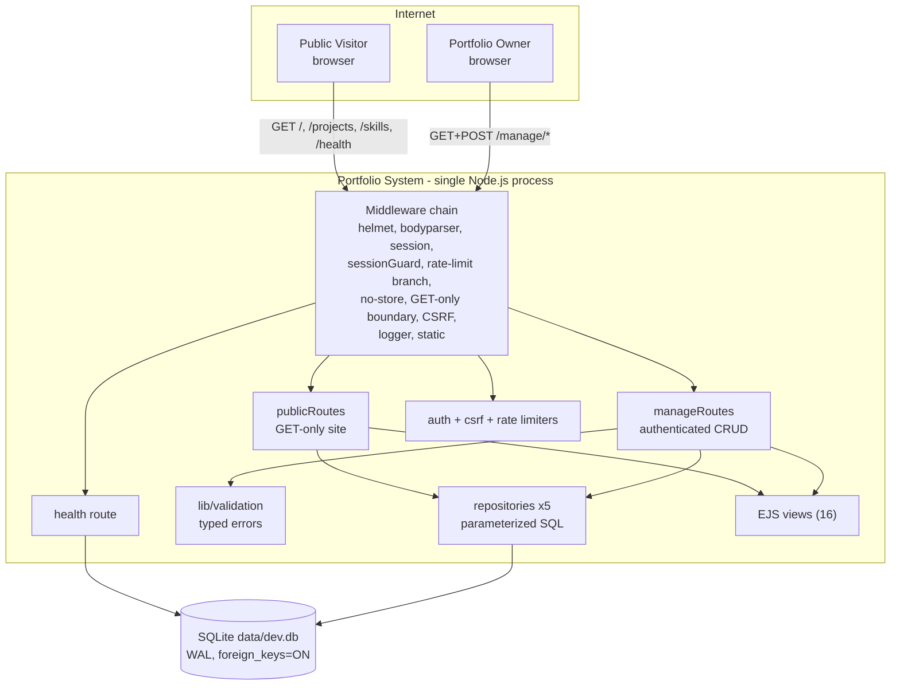
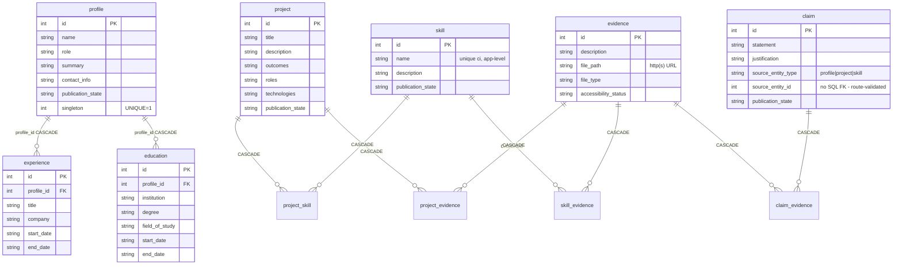

# SYSTEM_BLUEPRINT.md

**Document ID:** SYS-BLUEPRINT-001 · **Version:** 1.0 · **Date:** 2026-10-10
**Basis:** Full read of `src/`, `tests/`, `docs/`, config, and live runtime verification performed on 2026-10-10 (38/38 tests, lint clean, live boot, health check, 405 contract).
**Companion:** `BUILD_ROADMAP.md` (what to build next, in what order).

---

## 1. SYSTEM IDENTITY

### 1.1 One-paragraph summary
This is a **single-user, evidence-first portfolio system for a software engineer**. It lets the engineer (the only authenticated user) author professional content — profile, projects, skills, claims, and evidence references — in a private, session-protected management interface, and deliberately publish it to a **GET-only public website** where recruiters, hiring managers, technical interviewers, and clients can **trace every claim to evidence** with an honest accessibility label (Public / Private-Restricted / Redacted / Unavailable). It replaces the unverifiable resume format with a claim→evidence→artifact chain, and stores references only — never artifact content. Evidence: `docs/00-SYSTEM-VISION.md:8-21`, `docs/03-REQUIREMENTS.md:14-15`, `README.md:1-3`.

### 1.2 Domain and scope boundaries
- **Domain:** professional-credential presentation and verification (not HR systems, not generic CMS).
- **In scope** (evidence: `docs/SYSTEM-ARCHITECTURE-AND-IMPLEMENTATION-ROADMAP.md:48`): public evidence system, private management system, content management, evidence traceability, publication-state management, session auth for the private system, responsive/accessible server-rendered HTML, SQLite persistence, npm, CI/CD, Docker, structured logging intent.
- **Implemented in scope** (evidence: code + tests): everything above **except** GitHub Actions, Docker, and structured logging aggregation — see §8.
- **Non-goals / out of scope** (evidence: `docs/SYSTEM-ARCHITECTURE-AND-IMPLEMENTATION-ROADMAP.md:49`, `docs/03-REQUIREMENTS.md:382-398`): CV/resume generation (FR-007, P1-deferred), advanced performance optimization (FR-010), SEO/analytics, third-party validation, AI summarization, skill graphs, AR/VR, multi-user accounts, file uploads, artifact hosting. The system stores **URLs/references** to artifacts, never the artifacts.

---

## 2. ARCHITECTURE MAP

### 2.1 Topology (C4-L2 container view — as built)

### 2.2 Component register

| Component | Responsibility | Inputs | Outputs | Depends on | Owned data | Evidence |
|---|---|---|---|---|---|---|
| `src/server.js` | Process entry: load `.env`, validate `PORT` (1–65535), call `startServer` | env | HTTP listener | app.js | — | `src/server.js:6-16` |
| `src/app.js` (`createApp`) | Assemble the entire middleware chain in fixed order; fail-fast config validation; graceful SIGINT/SIGTERM shutdown | HTTP requests | Express app | all middleware + routes | — | `src/app.js:26-145` |
| `src/config/database.js` | Singleton better-sqlite3 connection; verifies `PRAGMA foreign_keys=ON` (fails fast if not 1), enables WAL, applies `schema.sql` idempotently | env (`NODE_ENV`, `DB_PATH`) | `Database` handle | better-sqlite3 | the DB file itself | `src/config/database.js:22-51` |
| `src/routes/health.js` | Liveness+readiness: `SELECT 1` probe | GET /health | 200 `{status:OK,database:up}` / 503 | database.js | — | `src/routes/health.js:13-21` |
| `src/routes/publicRoutes.js` | GET-only public site: home (profile-gated), project list/detail, skill list/detail; published-only filtering; claim→evidence nesting | requests | HTML (EJS) | repositories, views | — | `src/routes/publicRoutes.js:18-80` |
| `src/routes/manageRoutes.js` | Full management surface: login/logout, dashboard, profile, projects, skills, claims, evidence, publish/unpublish, attach-links, preview | requests (form-encoded, `_csrf`) | 303 redirects / HTML / error pages | repos, validation, auth | — | `src/routes/manageRoutes.js:22-472` |
| `src/repositories/*` (5 files) | All SQL. Enforce: profile singleton (app-level + schema), case-insensitive skill-name uniqueness, 409 ConflictError on claim-referenced project/skill delete, claim-delete cascades links only, evidence-delete cascades joins only | repo calls | row objects / ids / booleans / throws | database.js | SQL statements | `src/repositories/*.js` |
| `src/middleware/auth.js` | Session lifecycle (30m idle / 24h absolute), `requireAuth` (302 for GET, 401 render for POST), bcrypt `verifyCredential` | session, env hash | auth state | express-session | session fields `createdAt,lastSeen,authenticated,csrfToken,returnTo` | `src/middleware/auth.js:3-63` |
| `src/middleware/csrf.js` | Synchronizer-token CSRF; issue per session; verify `_csrf` body field or `x-csrf-token` header on all non-safe methods → 403 | session, body | `res.locals.csrfToken` | express-session | — | `src/middleware/csrf.js:12-32` |
| `src/middleware/rateLimiters.js` | 100 req/min public, 10 req/min `/manage` (memory store); relaxed to 10 000 under `NODE_ENV=test` | env | 429 when exceeded | express-rate-limit | in-memory counters | `src/middleware/rateLimiters.js:7-25` |
| `src/middleware/noStore.js` | `Cache-Control: no-store` + `Pragma: no-cache` on all `/manage` responses | path | headers | — | — | `src/middleware/noStore.js:4-10` |
| `src/middleware/logger.js` | Request log line `METHOD path -> status (ms)`; no query strings/credentials; 5xx to `console.error`; `/health` silenced | res events | stdout | — | — | `src/middleware/logger.js:8-19` |
| `src/middleware/errorHandler.js` | Central error contract: 400/401/403/404/409 by typed error `status`; 500 otherwise; HTML vs JSON by `req.accepts('html')`; never leaks stacks to clients; logs only method/url/status/name/code | thrown errors | error pages / JSON | validation.js, database.js | — | `src/middleware/errorHandler.js:11-59` |
| `src/lib/validation.js` | `ValidationError(400)` / `ConflictError(409)` / `NotFoundError(404)`; enums `PUBLICATION_STATES`, `ACCESSIBILITY_STATES`, `CLAIM_SOURCES`; field validators (`requireText`, `optionalText`, `requireEnum`, `optionalInt`, `isHttpUrl`) | route inputs | validated values or populated `errors{}` | — | — | `src/lib/validation.js:3-101` |
| `src/views/**` (16 EJS) | All HTML: public (index, project/skill list+detail, error, partials) + manage (login, dashboard, profile, project list/form, skill list, claim list, evidence list) | route locals | HTML | styles.css | — | `src/views/` |
| `public/css/styles.css` | Responsive + accessible styling (focus-visible, 44px targets, reduced-motion, contrast) | — | CSS | — | — | `public/css/styles.css` |

### 2.3 Sync/async and state classification
- **Everything is synchronous request/response.** better-sqlite3 is synchronous by design (`src/config/database.js:36`). Zero queues, zero background jobs, zero outbound calls.
- **Stateful:** the SQLite file (all domain data) and in-process session store (express-session MemoryStore — sessions die on restart; accepted risk RISK-003, `docs/SYSTEM-ARCHITECTURE-AND-IMPLEMENTATION-ROADMAP.md:360`).
- **Stateless:** all HTTP handling besides sessions; the process can be replaced at any time; only the DB file persists.

### 2.4 Middleware order (the real "architecture spine")
`helmet → urlencoded/json(100kb) → session(portfolio.sid, rolling, 24h) → sessionGuard → rate-limit branch(/manage vs public) → noStore(/manage) → GET-only boundary(405 outside /manage) → CSRF → logger(+morgan dev) → static(public) → /health → /manage → / → 404 → errorHandler` — evidence: `src/app.js:44-123`. Two orderings are deliberate and test-locked: the 405 boundary precedes CSRF (so the method contract is not masked by token errors, `src/app.js:85-92`), and CSRF precedes `requireAuth` (unauthenticated POST with valid token → 401, with invalid token → 403; `tests/auth.test.js:18-29`).

---

## 3. DATA MODEL

### 3.1 Entities (SQLite — `src/db/schema.sql`)

| Table | Meaning | Key fields (type, constraint) | Evidence |
|---|---|---|---|
| `profile` | The engineer's identity — **hard singleton** | `id` PK; `name`,`role`,`summary` NOT NULL; `contact_info` NULL; `publication_state` CHECK ∈ {Draft,Published,Archived} default Draft; `singleton INTEGER NOT NULL CHECK(singleton=1) UNIQUE` | `schema.sql:3-14` |
| `project` | A piece of work | `title` NOT NULL (≤300 by route validation); `description`,`outcomes`,`roles`,`technologies`; `publication_state` enum | `schema.sql:16-26`, `manageRoutes.js:132-148` |
| `skill` | A named capability | `name` NOT NULL (case-insensitively unique — app-level, `skillRepository.js:23-26`); `description`; `publication_state` | `schema.sql:28-35` |
| `evidence` | A **reference** to an artifact (never content) | `description`,`file_path` (must be http(s) URL if set),`file_type`; `accessibility_status` CHECK ∈ {Public, Private/Restricted, Redacted, Unavailable} default Public | `schema.sql:37-45`, `manageRoutes.js:402-426` |
| `claim` | A verifiable statement, optionally anchored to a source entity | `statement` NOT NULL (≤1000); `justification` (≤5000); `source_entity_type` CHECK ∈ {profile,project,skill} NULL; `source_entity_id` NULL (polymorphic, **no SQL FK** — integrity enforced in route code `manageRoutes.js:313-323`); `publication_state` | `schema.sql:47-56`, `claimRepository.js:15-32` |
| `experience`, `education` | Career history rows for the (deferred) CV feature | FK `profile_id` → profile **ON DELETE CASCADE** | `schema.sql:58-83` |
| `project_skill`, `project_evidence`, `skill_evidence`, `claim_evidence` | N:M link tables, PK = (both ids), all FKs **ON DELETE CASCADE** | `created_at` | `schema.sql:85-119` |

**Deletion semantics (the integrity core):**
- Project/skill delete **blocked while claims reference it** → app-level pre-count + ConflictError 409 (`projectRepository.js:59-76`, `skillRepository.js:59-77`); covered by `tests/constraints.test.js:21`.
- Claim delete cascades `claim_evidence` links only; evidence rows survive (`claimRepository.js:57-65`); test `constraints.test.js:41`.
- Evidence delete cascades all three join tables; claims/projects survive (`evidenceRepository.js:37-45`).
- `updated_at` maintained by 7 triggers (`schema.sql:121-169`). Indexes on publication/accessibility/claim-source columns (`schema.sql:171-176`).

### 3.2 Value/enum domains
- `publication_state`: `Draft | Published | Archived` (`validation.js:28`). **Note: `Archived` is declared but unreachable** — no route sets it (grep across `src/`: only schema + constant). Public filter is strictly `= 'Published'` (`projectRepository.js:6`, `skillRepository.js:6`).
- `accessibility_status`: `Public | Private/Restricted | Redacted | Unavailable` (`validation.js:29`).
- Orthogonality invariant (frozen design, `docs/06-SYSTEM-ARCHITECTURE.md:85-88`): publication state (is the *content* public) ≠ accessibility (can the *artifact* be inspected). Public pages render accessibility honestly, including "supports no claims" and non-Public labels — test-locked (`tests/constraints.test.js:84`, `manageEvidenceList.test.js:38-44`).

### 3.3 Data lifecycle (birth → death)
1. **Born** in `/manage` forms → route validators (`manageRoutes.js` per-entity sections) → repository `INSERT` with `publication_state='Draft'` (e.g. `projectRepository.js:23-30`).
2. **Transformed** by edit routes (whitelisted column updates only, `projectRepository.js:32-47`) and by link attaches (`INSERT OR IGNORE` — idempotent).
3. **Activated** by explicit publish POSTs → `UPDATE ... SET publication_state='Published'`.
4. **Read** by public routes with `WHERE publication_state='Published'` (home additionally gates everything behind a Published profile: `publicRoutes.js:20-23`).
5. **Dies** only by explicit delete POSTs under the RESTRICT/cascade rules of §3.1. Nothing expires; no soft delete except the (currently unused) `Archived` state.

### 3.4 ERD

---

## 4. INTERFACES & CONTRACTS

### 4.1 Public surface (GET-only; rate 100/min/IP; 405 on any other method — `src/app.js:88-92`)

| Method+Path | Success | Errors | Behavior | Evidence |
|---|---|---|---|---|
| GET `/` | 200 HTML | — | Profile-gated: if profile missing/unpublished → placeholder hero, **no project/skill lists at all**; else published profile + published lists | `publicRoutes.js:18-26`, `index.ejs:4-17` |
| GET `/projects` | 200 HTML | — | Published projects, newest-first | `publicRoutes.js:28-33` |
| GET `/projects/:id(\d+)` | 200 HTML | 404 if not found **or not Published** | Detail with published claims (each claim nests its evidence), attached evidence (with honest accessibility labels), attached skills | `publicRoutes.js:35-54` |
| GET `/skills` | 200 HTML | — | Published skills, name-ordered | `publicRoutes.js:56-61` |
| GET `/skills/:id(\d+)` | 200 HTML | 404 as above | Detail with published claims + evidence | `publicRoutes.js:63-80` |
| GET `/health` | 200 JSON `{status:"OK",database:"up",timestamp}` | 503 JSON | Real `SELECT 1` probe | `health.js:13-21` |
| any non-GET outside `/manage` | — | **405 JSON** `{error:"Method Not Allowed"}` | Enforced globally before CSRF | `app.js:88-92` |
| anything unmatched | — | 404 (HTML for browsers, JSON otherwise) | | `app.js:110-120` |

### 4.2 Management surface (`/manage/*`; rate 10/min/IP; all responses `no-store`; POST requires CSRF; unauth GET→302 login, unauth POST→401)

| Method+Path | Purpose | Errors | Evidence |
|---|---|---|---|
| GET `/manage/login` | Login page (public; redirects to dashboard if authed) | — | `manageRoutes.js:22-25` |
| POST `/manage/login` | Sign in; **session regenerate** (fixation protection); CSRF token carried across rotation; 303 → `returnTo` or `/manage` | 401 wrong password; 403 CSRF; 500 regeneration failure | `manageRoutes.js:27-45` |
| POST `/manage/logout` | Destroy session; 303 → `/` | — | `manageRoutes.js:47-49` |
| GET `/manage` | Dashboard: content counts (total/published per type) | — | `manageRoutes.js:55-68` |
| GET/POST `/manage/profile` | Create-or-update the singleton profile (name≤200, role≤200, summary≤5000, contact≤2000) | 400 field errors | `manageRoutes.js:71-100` |
| POST `/manage/profile/publish` · `/unpublish` | Published ↔ Draft | 404 if no profile | `manageRoutes.js:102-118` |
| GET `/manage/projects`, `/manage/projects/new`; POST `/manage/projects` | List / new form / create (title≤300, description≤10000, outcomes≤5000, roles≤500, technologies≤1000) | 400 | `manageRoutes.js:121-148` |
| GET `/manage/projects/:id/edit`; POST `/manage/projects/:id` | Edit form / update | 404 | `manageRoutes.js:150-177` |
| POST `/manage/projects/:id/delete` | Delete — **409 while claims reference it** | 409 | `manageRoutes.js:179-184` |
| POST `/manage/projects/:id/publish|unpublish` | State flips | — | `manageRoutes.js:186-198` |
| POST `/manage/projects/:id/evidence` · `/skills` | Attach existing evidence/skill (idempotent) | 400 invalid id | `manageRoutes.js:200-220` |
| GET/POST `/manage/skills`; POST `/manage/skills/:id`; `.../delete`; `.../publish|unpublish`; `.../evidence` | Skill CRUD; **case-insensitive unique name** → 400 dupe; delete 409 while claims reference | 400/404/409 | `manageRoutes.js:222-298` |
| GET/POST `/manage/claims`; POST `/manage/claims/:id`; `.../delete`; `.../publish|unpublish`; `.../evidence` | Claim CRUD with optional polymorphic source (type+existence validated per type); delete cascades links only | 400/404 | `manageRoutes.js:300-392` |
| GET/POST `/manage/evidence`; POST `/manage/evidence/:id/accessibility`; `.../delete` | Evidence reference create (needs description or http(s) `file_path`); accessibility status change (enum-guarded); delete | 400/404 | `manageRoutes.js:394-445` |
| GET `/manage/preview/project/:id` · `/preview/skill/:id` | Render the **public templates** with all claims (including drafts) + `preview:true` | 404 | `manageRoutes.js:447-470` |

### 4.3 Global error contract (test-locked)

| Status | Cause | Shape |
|---|---|---|
| 400 | `ValidationError` | HTML error page w/ `fieldErrors`, or JSON `{error, fieldErrors}` |
| 401 | Unauthenticated POST (with valid CSRF) or bad login | HTML error page |
| 403 | Missing/invalid CSRF token | HTML error page, **no side effects** |
| 404 | Unknown path, non-numeric id classes, GET on POST-only manage route, unpublished public detail | HTML/JSON |
| 405 | Non-GET outside `/manage` | JSON |
| 409 | `ConflictError` (RESTRICT semantics) | HTML/JSON with explanatory message |
| 500 | Anything else | Generic message; details only in server log |

Evidence: `errorHandler.js:11-59`, `csrf.js:24-30`, `auth.js:40-52`, `app.js:88-92`; locked by `tests/auth.test.js`, `tests/manageEvidenceList.test.js:72-83`, `tests/constraints.test.js:21`.

### 4.4 Events/queues/CLI
- **None.** No message brokers, no events, no webhooks, no CLI beyond npm scripts: `start`, `dev`, `test`, `lint` (`package.json:6-11`).

---

## 5. RUNTIME & INFRA

### 5.1 Deployment topology (as-is)
Single Node process on the developer workstation (Windows), port 3000 (default), SQLite file at `data/dev.db` (dev) / `data/test.db` (test) / `DB_PATH` override (`database.js:26-35`). No reverse proxy, no TLS termination (production `Secure` cookies + `trust proxy: 1` are prepared for a proxied deployment, `app.js:46`). **No Docker/CI artifacts exist** [GAP — NOT FOUND IN ENV] despite being declared in scope (`docs/SYSTEM-ARCHITECTURE-AND-IMPLEMENTATION-ROADMAP.md:48`).

### 5.2 Config surface (complete)

| Var | Required | Controls | Evidence |
|---|---|---|---|
| `SESSION_SECRET` | Yes, ≥32 chars — fail-fast at boot | Session cookie signing | `app.js:28-30` |
| `OWNER_BCRYPT_HASH` | Yes, present — fail-fast | The single management credential (bcrypt ≥12 rounds; compareSync) | `app.js:31-33`, `auth.js:55-63` |
| `PORT` | No (3000) | Listen port; must be integer 1–65535 | `server.js:12-16` |
| `NODE_ENV` | No (development) | `development/test/production`: DB filename, Secure cookies, trust proxy, morgan dev, rate-limit test relaxation | `database.js:26-35`, `app.js:20,46,99`, `rateLimiters.js:7` |
| `DB_PATH` | No | Absolute/relative SQLite path override | `database.js:28-29` |

`.env` is loaded only if present, never committed (`.gitignore:5-6`; `server.js:6-8`). Actual `.env` exists with all five keys set (names verified only — values never read).

### 5.3 Observability
- **Logs:** custom request logger (`logger.js`) + morgan `dev` outside production + JSON context on 5xx (`method,url,status,name,code`, DB error code) (`errorHandler.js:21-26`). stdout only. No query strings, credentials, cookies, or session ids are ever logged.
- **Metrics: none** [GAP]. **Traces: none** [GAP]. **Alerts: none** [GAP].
- **Health:** `/health` is the single readiness probe (process + DB), suitable for container/Docker health checks.

---

## 6. SECURITY & AUTH

### 6.1 AuthN
- **Single actor.** One owner credential; bcrypt hash stored in `OWNER_BCRYPT_HASH` env (never in DB). Constant-time `bcrypt.compareSync` (`auth.js:55-63`).
- Login POST → 401 on wrong password; on success `session.regenerate` (fixation defense) with CSRF token rebound to the fresh session, then 303 to safe `returnTo` (only paths starting `/manage` accepted) (`manageRoutes.js:27-45`).
- Sessions: cookie `portfolio.sid`, HttpOnly, SameSite=Lax, Secure in production, 24 h maxAge, rolling refresh; MemoryStore. Lifecycle guard: 30 m idle / 24 h absolute → destroy + fresh anonymous session (`auth.js:12-33`).
- `requireAuth`: GET/HEAD → 302 `/manage/login` (with `returnTo`); POST → 401 HTML (`auth.js:40-52`).

### 6.2 AuthZ
- Two flat zones: public read-only (`GET` only, published rows only) and owner (everything under `/manage`). No roles beyond this. Rate limiting doubles as brute-force throttle on the login path (10/min).

### 6.3 CSRF
- Synchronizer token: 32 random bytes hex per session (`csrf.js:15`); checked on every non-safe method via `_csrf` field or `x-csrf-token` header; mismatch → 403 with zero side effects. All manage forms carry it (`tests/helpers.js:22-26` extraction pattern). CSRF precedes auth, so unauthenticated POSTs with valid tokens get 401, not 403 (`tests/auth.test.js:23-29`).

### 6.4 Headers, caching, limits
- helmet defaults (CSP `default-src 'self'`, nosniff, frameguard, HSTS, …) — `app.js:51`, verified `tests/auth.test.js:77-81`. `no-store` on all `/manage` responses (`noStore.js`, verified `auth.test.js:71-75`, `manageEvidenceList.test.js:46-52`). Rate limits §4. Body limit 100 KB (`app.js:54-55`). `x-powered-by` disabled (`app.js:45`).

### 6.5 Trust boundaries & sensitivity
| Boundary | Trust | Protection |
|---|---|---|
| Internet → public site | Untrusted | GET-only, published-only query filters, rate 100/min, helmet |
| Internet → `/manage` | Hostile until proven | rate 10/min, CSRF, session auth, no-store, bcrypt |
| App → SQLite | Trusted (local file) | parameterized statements only (all repositories); PRAGMA FK enforcement |
| Env → process | Trusted (owner-managed) | fail-fast validation; secrets never logged |

- Secrets inventory (names only): `SESSION_SECRET`, `OWNER_BCRYPT_HASH` in `.env` (gitignored); test credential hardcoded **in tests only** (`tests/helpers.js:8`).
- SQL injection: impossible by construction — every statement is prepared/parameterized (`src/repositories/*.js`).
- XSS: EJS `<%= %>` escaping throughout the public templates (e.g. `index.ejs:5-9`); no `<%- %>` user-content interpolation found in public views.

---

## 7. EXTERNAL DEPENDENCIES

| Dependency | Role | Failure mode | Evidence |
|---|---|---|---|
| Node.js runtime (v24 per roadmap audit) | Process host | process down → site down | `docs/SYSTEM-ARCHITECTURE-AND-IMPLEMENTATION-ROADMAP.md:284` |
| express ^4.18 | HTTP framework | — | `package.json:20` |
| better-sqlite3 ^11 | Sync SQLite driver; native module | rebuild needed on Node major upgrades | `package.json:17` |
| express-session ^1.17 | Session mgmt (MemoryStore) | **restart loses sessions** (accepted RISK-003) | `package.json:22` |
| helmet ^7 / express-rate-limit ^6 / morgan ^1.10 | Headers / limits / logs | — | `package.json:18-24` |
| bcryptjs ^2.4.3 | Credential verify | CPU cost per login (~300 ms observed in test logs) | `package.json:16` |
| ejs ^3.1.10, dotenv ^16 | Views, env load | — | `package.json:18,19` |
| jest ^30, supertest ^7, eslint ^9, nodemon ^3 (dev) | Verification toolchain | 22 known dev-only audit findings (documented, accepted) | `package.json:26-32`, roadmap `:479` |

**Runtime outbound network calls: zero.** The app never calls third-party APIs. "Evidence" `file_path` values are external URLs rendered as links only (`manageRoutes.js:407-409` enforces http(s) shape; nothing is fetched).

---

## 8. CURRENT STATE vs INTENDED STATE

### 8.1 Implemented and verified (evidence: tests + live boot this session)
All P0 functional scope: FR-001 profile, FR-002 project evidence, FR-003 claim↔evidence bidirectional traceability, FR-004 skills with evidence, FR-005 private CMS + publish, FR-006 accessibility honesty, FR-008 responsive CSS, NFR-002 content/presentation separation; security posture per §6 (NFR-001 mechanics). **Verified 2026-10-10: 6 suites / 38 tests green, ESLint clean, live boot with health OK and 405 contract working.**

| Suite | Locks |
|---|---|
| `health.test.js` | health contract |
| `auth.test.js` (12) | 302/401/403 ordering, rotation, logout, no-store, helmet, cookie flags |
| `publication.test.js` (3) | draft invisibility → publish → visible → unpublish → 404; public 405 |
| `content.test.js` | all manage CRUD flows, validation 400s |
| `constraints.test.js` | singleton 409, project-delete 409 while claimed, claim-delete link cascade, URL/enum validation, honesty rendering |
| `manageEvidenceList.test.js` (8) | evidence listing, reverse traceability, 401/404 contracts, no-store |

### 8.2 Stubbed / partial / missing
| Item | State | Evidence |
|---|---|---|
| Git repository | **Missing** — not a repo | `Test-Path .git → False`; roadmap `:486` |
| GitHub Actions CI | **Missing** despite in-scope declaration | no `.github/` |
| Dockerfile / compose | **Missing** despite in-scope declaration | no Docker artifacts |
| Migrations framework | **Missing** — idempotent `CREATE IF NOT EXISTS` only; cannot evolve schema against an existing dev.db | `database.js:9-13` |
| `Archived` publication state | Declared (schema+enum) but **unreachable** — no route sets it | grep §3.2 |
| `experience` / `education` tables | Schema present, **no repository, no routes, no UI** (FR-007 foundation, deferred) | `schema.sql:58-83`; no `experienceRepository.js` |
| INC-010 remainder (axe-core, Lighthouse) | **Open** | roadmap `:484` |
| CV/resume generation (FR-007) | Not started (P1-deferred by design) | `docs/03-REQUIREMENTS.md:152-166` |
| Pagination / search | Not implemented (deferred UNQs) | roadmap `:64-65` |
| Persistent session store | MemoryStore only (single-instance assumption) | roadmap `:61`, RISK-003 |

### 8.3 Contradictions & drift found (fix candidates)
1. **Roadmap test-count drift:** roadmap v0.2 says "26/26 automated tests" / 5 suites (`:432,481`); reality is **38 tests / 6 suites** (verified). `manageEvidenceList.test.js` postdates the roadmap update.
2. **Roadmap self-contradiction on module status:** the Module Catalogue table lists MOD-002/003/004/006/007 as "NOT STARTED" (`:270-275`) while the Progress Dashboard marks all 7 "TESTS PASSING" (`:422-432`). The catalogue is stale.
3. **Ghost route `GET /claims` in the roadmap's context diagram** (`:98`) — no such public endpoint exists; claims are rendered inside project/skill detail pages only (`publicRoutes.js`).
4. **Roadmap dependency text mentions `csurf`** (`:162,361`) — replaced by the session-stored synchronizer token (roadmap `:479` itself records the replacement; the diagrams lag).
5. README claims "26/26 automated tests" (`README.md:8`) — same drift as (1).

### 8.4 Dead code
None found (dissection ledger agrees, `docs/16-SYSTEM-DISSECTION-AND-ADJUSTMENT-LEDGER.md:38`). Closest to dead: `Archived` enum value, unused `experience`/`education` tables, `PUBLICATION_STATES` export with only 2 live states — all documented as deferred hooks, not junk.

---

## 9. OPEN QUESTIONS / GAPS

| # | Gap [GAP — NOT FOUND IN ENV] | Artifact needed to close it |
|---|---|---|
| G-1 | Git repository absent | `git init` + initial commit of verified baseline (roadmap's own declared immediate action) |
| G-2 | CI/CD pipeline absent | `.github/workflows/ci.yml` (install → lint → test → audit) + hosted repo |
| G-3 | Containerization absent | `Dockerfile` (multi-stage, non-root, `/health` healthcheck), `.dockerignore`, optional `docker-compose.yml` |
| G-4 | Migration tooling absent | versioned migration runner (e.g. numbered SQL + applied-migrations table) **before** any schema change |
| G-5 | Structured logging / metrics / traces / alerts absent | chosen format (JSON lines) + optional host-level aggregation; not required for MVP |
| G-6 | axe-core + Lighthouse verification results absent | INC-010 pass in a browser-enabled environment |
| G-7 | FR-007 experience/education feature absent | UI decision + repository + routes + views + tests (schema already exists) |
| G-8 | `Archived` state semantics undefined in code | decision: implement an Archive action or remove the enum value from docs |
| G-9 | Deployment environment unspecified (host, TLS, domain) | user decision — required before Docker hardening (Secure cookies need HTTPS) |
| G-10 | Node version pinning absent | `engines` field in `package.json` and/or `.nvmrc` |
| G-11 | Backup/restore procedure for `data/dev.db` undefined | ops runbook entry (single-file DB; WAL sidecars) |

---

## 10. USE CASES (Phase 2)

### UC-001 | View published portfolio home | Actor: Public Visitor [EVIDENCED: src/routes/publicRoutes.js:18-26]
- **Preconditions:** app running; profile exists and is Published.
- **Trigger:** GET `/`.
- **Main flow:** 1) middleware chain (§2.4) 2) route loads profile 3) if Published → load published projects+skills 4) render `index.ejs` with escaped identity + card/chip lists.
- **Alternate:** profile missing/Draft → placeholder "not published yet", lists suppressed (tests: `publication.test.js` semantics).
- **Postconditions:** none (read-only).
- **Failure:** DB error → 500 page via errorHandler.
- **Modules:** publicRoutes, profileRepo, projectRepo, skillRepo, index.ejs.
- **Data:** `profile`, `project`, `skill` (Published rows only).
- **Metric:** recruiter understands identity in ≤30 s (`docs/00-SYSTEM-VISION.md:18`).

### UC-002 | Inspect a project with claim→evidence traceability | Actor: Visitor [EVIDENCED: publicRoutes.js:35-54]
- **Preconditions:** project Published.
- **Trigger:** GET `/projects/:id`.
- **Main flow:** load project → 404 unless Published → load published claims → for each claim load its evidence (`claimRepo.listEvidence`) → load attached evidence + skills → render detail with honest accessibility labels.
- **Alternate:** Draft/unpublished/unknown id → 404 page (locked by `publication.test.js:49-50`).
- **Failure:** DB error → 500.
- **Modules:** publicRoutes, projectRepo, claimRepo, `projects/detail.ejs`.
- **Data:** project, claim (+claim_evidence), evidence, skill, project_skill.
- **Metric:** evaluator traces ≥1 claim to evidence (`docs/00-SYSTEM-VISION.md:19`).

### UC-003 | Browse skills | Actor: Visitor [EVIDENCED: publicRoutes.js:56-80]
Same pattern as UC-002 for `/skills` and `/skills/:id` (claims, evidence; no skills-of-skill section).

### UC-004 | Draft isolation enforcement | Actor: Visitor (adversarial) [EVIDENCED: tests/publication.test.js]
- **Trigger:** GET of an unpublished detail; POST anywhere public.
- **Flow:** detail → 404; public POST → 405 before CSRF (`app.js:88-92`).
- **Failure mode covered:** information leak of WIP — mitigated at query level (`publication_state='Published'` filters, roadmap RISK-005).

### UC-005 | Owner sign-in / sign-out | Actor: Owner [EVIDENCED: manageRoutes.js:22-49; tests/auth.test.js]
- **Preconditions:** `OWNER_BCRYPT_HASH` configured.
- **Trigger:** GET `/manage` unauthenticated → 302 login with `returnTo`.
- **Main flow:** GET login (token issued) → POST password+`_csrf` → 401 if wrong → regenerate session, rebind CSRF, set timestamps → 303 `returnTo`.
- **Alternates:** CSRF missing/wrong → 403 pre-auth (`auth.test.js:31-42`); logout destroys session → 303 `/`.
- **Failure:** session regenerate error → 500 page.
- **Modules:** auth, csrf, manageRoutes, login.ejs.
- **Data:** session store only.
- **Metric:** unauthorized access blocked (NFR-001).

### UC-006 | Manage profile (create → edit → publish/unpublish) | Actor: Owner [EVIDENCED: manageRoutes.js:71-118; content.test.js]
- **Flow:** GET form (blank or values) → POST validated (name/role/summary required, ≤200/200/5000; contact ≤2000) → 400 re-render with `fieldErrors` → create-or-update singleton → publish/unpublish flips visibility of the entire home page (UC-001 gate).
- **Failure:** 409 second-create impossible (singleton guard `profileRepository.js:25-30`, `constraints.test.js:14`).

### UC-007 | Create, publish, link, and delete a project | Actor: Owner [EVIDENCED: manageRoutes.js:121-220]
- **Main flow:** create (Draft) → attach evidence and/or skills by id (existence-checked, idempotent) → preview (UC-011) → publish → visible publicly → edit → unpublish → delete.
- **Alternate/failure:** delete while claims reference → 409 with count message (`projectRepository.js:59-66`, `constraints.test.js:21`).

### UC-008 | Manage skills | Actor: Owner [EVIDENCED: manageRoutes.js:222-298]
CRUD + publish + attach evidence; duplicate name (case-insensitive) → 400; delete 409 while claimed (`skillRepository.js:59-66`).

### UC-009 | Manage claims with polymorphic source | Actor: Owner [EVIDENCED: manageRoutes.js:300-392]
- **Main flow:** create claim with statement/justification, optional `source_entity_type`+`source_entity_id`; route verifies the referenced record exists per type (profile/project/skill) before insert; attach evidence (bidirectional: evidence page lists its claims — `evidenceRepository.js:47-53`); publish/unpublish; delete cascades links only.
- **Failure:** dangling source id → 400 field error (`manageRoutes.js:317-323`).

### UC-010 | Manage evidence references | Actor: Owner [EVIDENCED: manageRoutes.js:394-445]
- **Main flow:** create with description and/or http(s) URL (≥1 required) → set accessibility status (4-value enum) → delete (join cascade).
- **Invariant:** public rendering always shows the true accessibility status, "supports no claims" when unlinked (`manageEvidenceList.test.js:38-52`, `constraints.test.js:84`).

### UC-011 | Preview drafts before publishing | Actor: Owner [EVIDENCED: manageRoutes.js:447-470]
Renders the exact public templates with `preview:true` and **all** claims (published+draft) so the owner sees what publish would look like. Preview URLs are manage-gated and no-store.

### UC-012 | Health probing | Actor: Ops/monitor [EVIDENCED: health.js]
GET `/health` → 200 with DB probe or 503; designed as the container/orchestrator healthcheck.

### UC-013 | Graceful shutdown | Actor: Ops [EVIDENCED: app.js:134-143]
SIGINT/SIGTERM → stop accepting, close server, close DB, exit 0; hard exit after 5 s.

### UC-014 | Release the system (git → CI → container → deploy) | Actor: Owner as ops [INFERRED — from roadmap `:483-489` "Remaining open work" and confirmed absences G-1..G-3]
No flow exists yet; this is the primary build target of `BUILD_ROADMAP.md`.

### UC-015 | Maintain experience/education for CV (FR-007) | Actor: Owner [INFERRED — schema exists, zero code]
Blocked on FR-007 authorization; requires MODULE-005 in the roadmap plus migration discipline (G-4).

### UC-016 | Recover from validation/CSRF errors | Actor: Owner [EVIDENCED: errorHandler.js, csrf.js]
400 re-renders the form with values + field errors; 403 CSRF instructs reload-and-retry; no partial writes ever occur (validation precedes repository calls on every route).
