# UML_DIAGRAMS.md

**Document ID:** SYS-UML-001 · **Version:** 1.0 · **Date:** 2026-10-10
**Purpose:** Understand the Portfolio System through the full standard UML diagram set — every diagram grounded in the actual code (evidence = `file:line`). Companion to `SYSTEM_BLUEPRINT.md` (narrative) and `BUILD_ROADMAP.md` (build order).
**Rendering:** All diagrams are Mermaid. View in any Mermaid-capable renderer (VS Code extension, GitHub, mermaid.live).
**Convention:** `[EVIDENCED: path:lines]` = read directly from code/tests. `[INFERRED]` = derived, marked where applicable. All sample values in the object diagram are illustrative.

---

## Diagram inventory

| ID | UML type | Question it answers |
|---|---|---|
| D-UC-01 | Use Case diagram | *Who* can do *what* to the system? |
| D-CD-01 | Class diagram (domain) | *What* are the business objects and their rules? |
| D-CD-02 | Class diagram (application) | *What* code implements the behavior? |
| D-PKG-01 | Package diagram | *How is the source* organized and layered? |
| D-CMP-01 | Component diagram | *What are the replaceable parts* and their interfaces? |
| D-OBJ-01 | Object diagram (snapshot) | *What does the data look like* at runtime? |
| D-SM-01..03 | State machine diagrams | *What states* exist and *what transitions* are legal? |
| D-ACT-01..03 | Activity diagrams | *What are the flows*, branches and decisions? |
| D-SEQ-01..08 | Sequence diagrams | *Who calls whom, in what order* over time? |
| D-COM-01 | Communication diagram | *Which objects collaborate* on the critical flow (login)? |
| D-DEP-01 | Deployment diagram | *Where does it run* and what artifacts are deployed? |
| D-ERD-01 | ER diagram (persistence view) | *How is data stored* in SQLite? |

Deliberately omitted: timing diagram (no time-critical resource contention exists in this system — all handlers are synchronous, `src/config/database.js:36`); UML profile diagrams (no stereotypes to formalize beyond the ones used here).

---

## D-UC-01 — Use Case Diagram

**Teaches:** the two-zone permission model — a read-only public surface (Visitor) and an all-powerful authenticated surface (Owner) — plus the system-enforced isolation that visitors can never bypass. [EVIDENCED: `src/routes/publicRoutes.js`, `src/routes/manageRoutes.js:22-52`, `src/middleware/auth.js:40-52`]

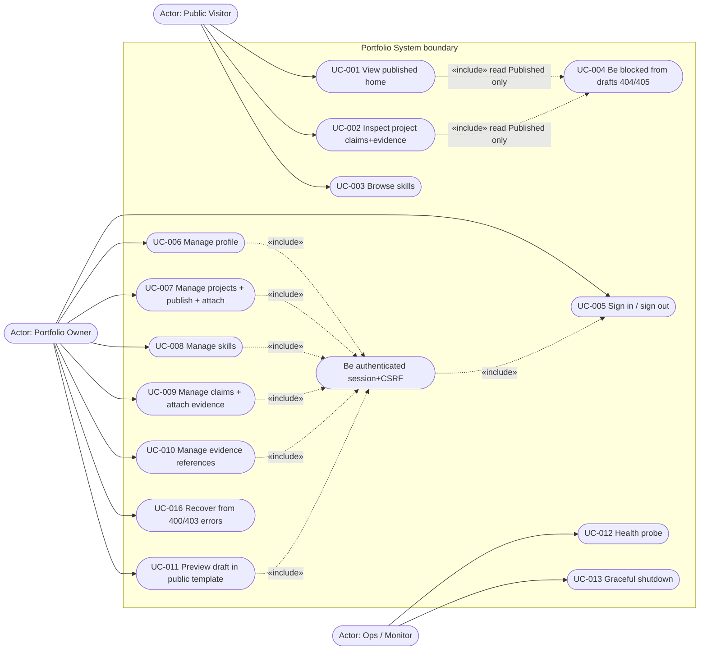

Notes:
- The **Planned** use cases UC-014 (release: git→CI→Docker) and UC-015 (experience/education, FR-007) are outside this diagram because no code path exists — see `BUILD_ROADMAP.md` MODULE-008..013. [INFERRED from `docs/SYSTEM-ARCHITECTURE-AND-IMPLEMENTATION-ROADMAP.md:483-489`]
- `UC-004` is drawn as an included use case because draft isolation is enforced inside every public read (`WHERE publication_state='Published'`, `src/repositories/projectRepository.js:6`) and by the global 405 boundary (`src/app.js:88-92`), not as a separate feature.

---

## D-CD-01 — Class Diagram: Domain Model

**Teaches:** the claim→evidence chain, the singleton profile, the polymorphic claim source, and the exact cascade/RESTRICT deletion semantics that produce 409s. [EVIDENCED: `src/db/schema.sql:3-119`, `src/lib/validation.js:28-30`]

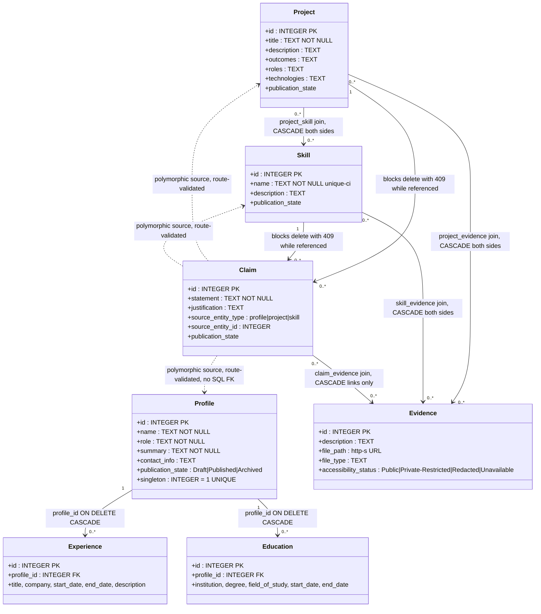

Key rules the diagram encodes:
- A **claim may exist with zero evidence** (frozen business rule, `src/repositories/claimRepository.js:15-19`).
- **Claim↔Evidence is N:M** via `claim_evidence`; deleting a claim keeps evidence rows (`claimRepository.js:57-65`, test `tests/constraints.test.js:41`).
- **Project/Skill delete is RESTRICT vs claims** at application level → `ConflictError` 409 (`projectRepository.js:59-76`, `skillRepository.js:59-77`).
- **Evidence delete cascades all three joins**; projects/skills/claims survive (`evidenceRepository.js:37-45`).
- `source_entity_type/id` is a **polymorphic reference with no SQL foreign key** — referential integrity is enforced in route code only (`manageRoutes.js:313-323`). This is the model's one deliberate integrity compromise.

---

## D-CD-02 — Class Diagram: Application Structure

**Teaches:** the layered call graph — routes → repositories → database — and where the typed errors come from. All repository methods are static module functions (CommonJS modules, not classes); drawn as `<<module>>` with static operations. [EVIDENCED: file set under `src/`]

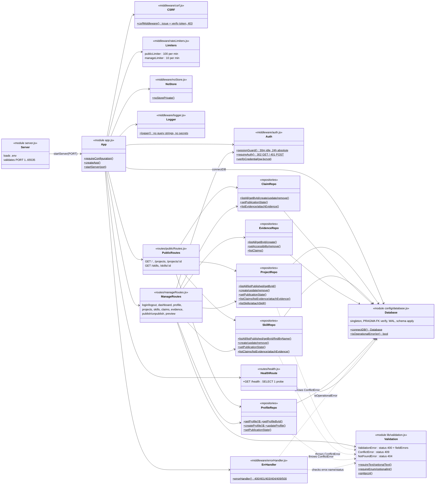

---

## D-PKG-01 — Package Diagram

**Teaches:** the layering discipline — `routes` may call `repositories`, never SQL directly; `repositories` are the only SQL owners; nothing outside `lib/validation` defines the error contract. [EVIDENCED: directory structure, import graph in each file header]

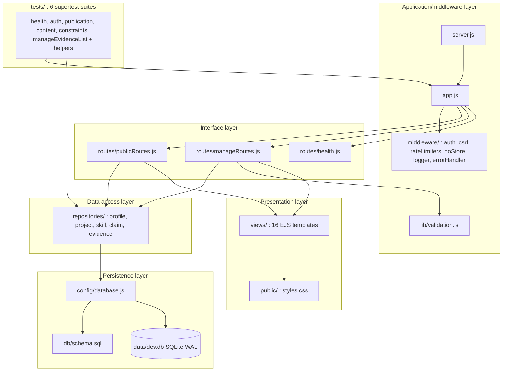

Prohibited edges (enforced by inspection, `docs/06-SYSTEM-ARCHITECTURE.md:189-197`): public routes contain no write statements; repositories contain no request/response logic; `views/` contains no data access.

---

## D-CMP-01 — Component Diagram

**Teaches:** the three replaceable components and their narrow interfaces — the persistence component hides SQLite behind `connectDB()`; the security component wraps every management interaction; the presentation component is swappable templates. [EVIDENCED: `src/app.js:104-107` wiring, module exports of each file]

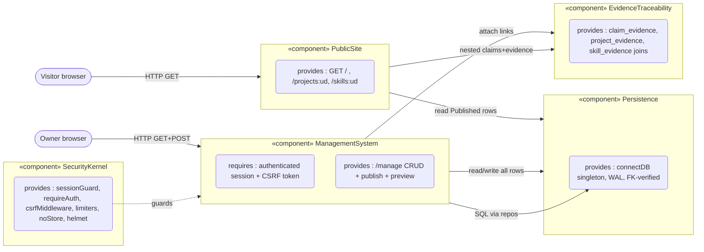

---

## D-OBJ-01 — Object Diagram (runtime snapshot, illustrative values)

**Teaches:** what draft isolation means concretely — same DB holds a Published and a Draft project; the public site renders only the Published one; evidence accessibility is orthogonal to publication. **Values are illustrative, not from your dev.db.** [Structure EVIDENCED: `schema.sql`; behavior EVIDENCED: `tests/publication.test.js`, `tests/constraints.test.js:84`]

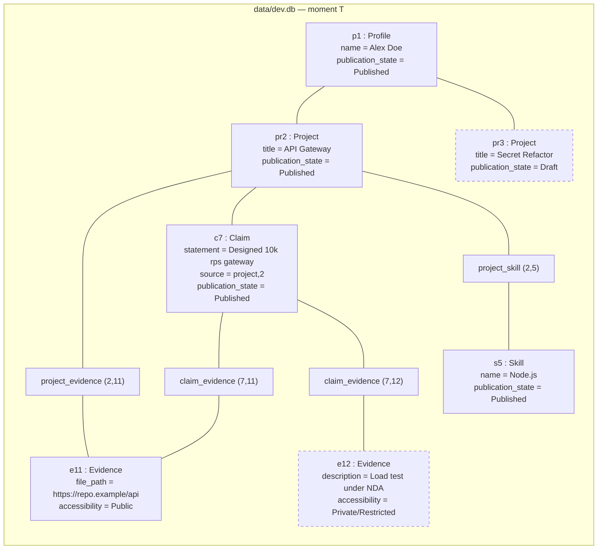

Rendered consequences: `GET /projects` lists pr2 but **never pr3**; `GET /projects/2` shows c7 with e11 as a clickable link and e12 as an honest "Private/Restricted" label with no URL exposed.

---

## D-SM-01 — State Machine: `publication_state` (profile, project, skill, claim)

**Teaches:** the whole publishing business model in one picture — including that `Archived` is **declared but unreachable** (no code path sets it), and that delete is legal from Draft *and* Published unless claims block it. [EVIDENCED: `schema.sql:9,23,32,53`; `manageRoutes.js` publish/unpublish routes; grep: `Archived` appears only in schema + `validation.js:28`]

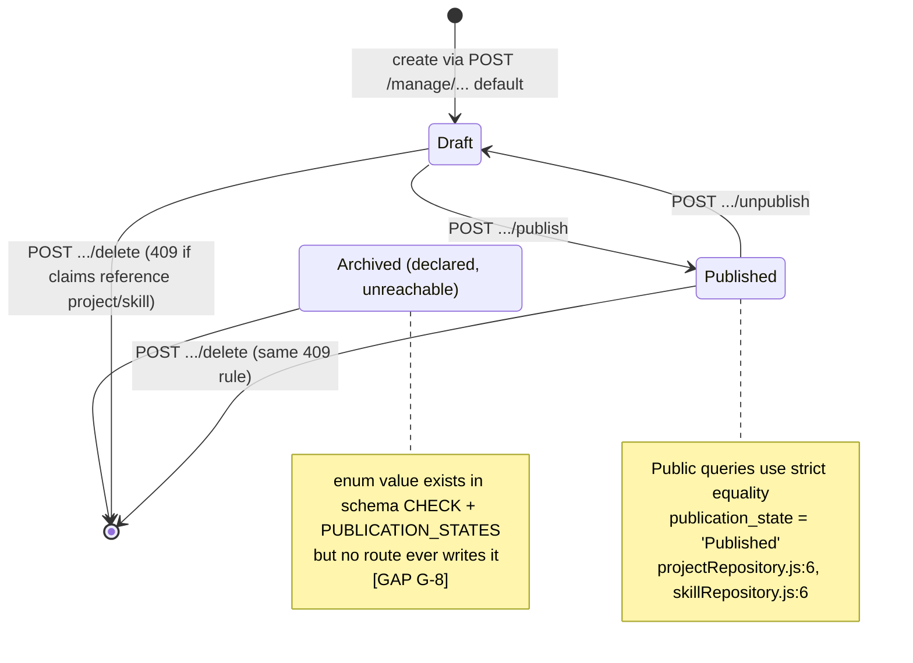

---

## D-SM-02 — State Machine: `evidence.accessibility_status`

**Teaches:** accessibility is an independently settable 4-state field (default `Public` on create) — orthogonal to publication state by frozen design. [EVIDENCED: `evidenceRepository.js:19-26` default, `manageRoutes.js:428-437` transition endpoint, `validation.js:29` enum]

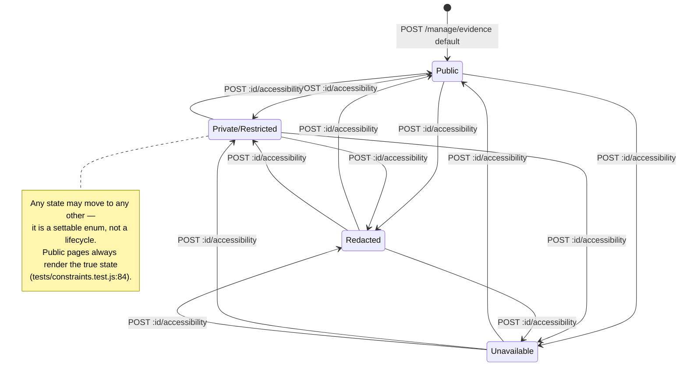

---

## D-SM-03 — State Machine: Session lifecycle

**Teaches:** how one anonymous session becomes the owner session and how it dies — rotation at login, token rebind, the two timeouts, and MemoryStore volatility across restarts. [EVIDENCED: `src/middleware/auth.js:12-33`, `src/routes/manageRoutes.js:27-49`, `src/app.js:59-71`]

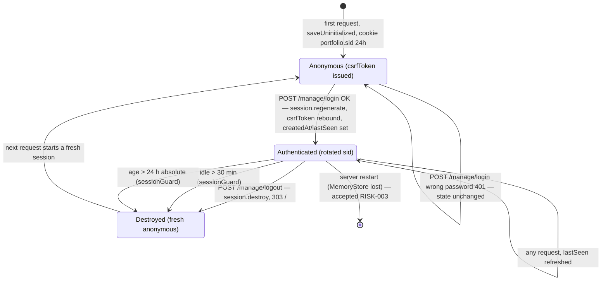

---

## D-ACT-01 — Activity Diagram: Request lifecycle (the middleware spine)

**Teaches:** the exact decision order that produces the famous status codes — 405 before CSRF, CSRF before auth, rate limit before everything private. Order is test-locked. [EVIDENCED: `src/app.js:44-123`; `tests/auth.test.js:18-29`, `tests/publication.test.js:69-72`]

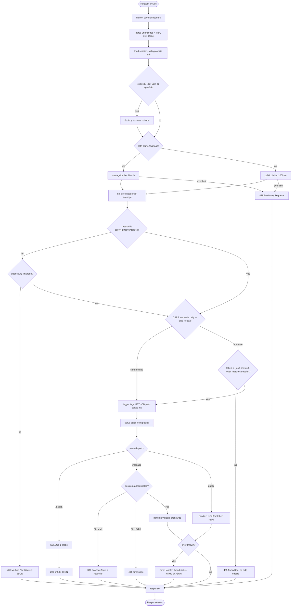

---

## D-ACT-02 — Activity Diagram: Publication workflow (owner)

**Teaches:** the deliberate Draft→Preview→Publish loop and the validation/409 guard rails around it. [EVIDENCED: `manageRoutes.js:121-220, 447-470`; `tests/publication.test.js`]

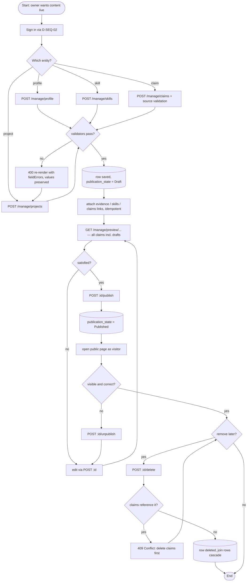

---

## D-ACT-03 — Activity Diagram: Evidence creation + accessibility

**Teaches:** the honesty invariant mechanics — a reference must be describable, URLs must be http(s), and accessibility defaults to Public and is changed only via the dedicated endpoint. [EVIDENCED: `manageRoutes.js:402-445`, `evidenceRepository.js:19-35`]

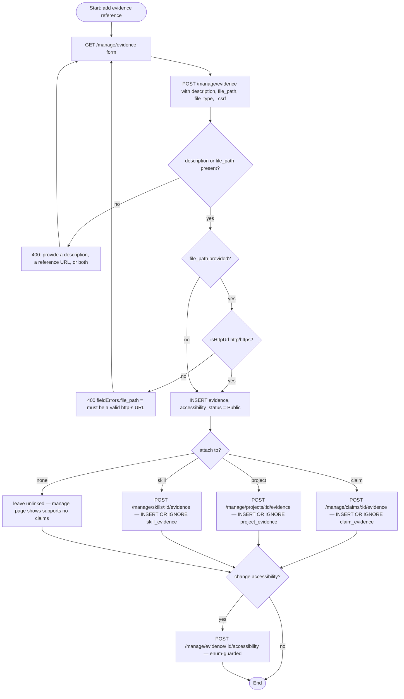

---

## D-SEQ-01 — Sequence: Visitor inspects a published project (UC-002)

**Teaches:** the three-query traceability render — project row, claims, per-claim evidence — and the 404 guard for anything unpublished. [EVIDENCED: `publicRoutes.js:35-54`]

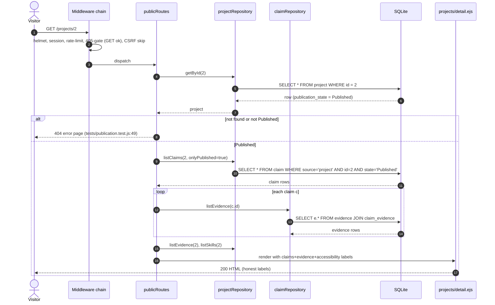

---

## D-SEQ-02 — Sequence: Owner signs in (UC-005)

**Teaches:** CSRF-before-auth ordering, bcrypt verification, session rotation with token rebind, and safe `returnTo`. [EVIDENCED: `manageRoutes.js:22-49`; `tests/auth.test.js:18-60`]

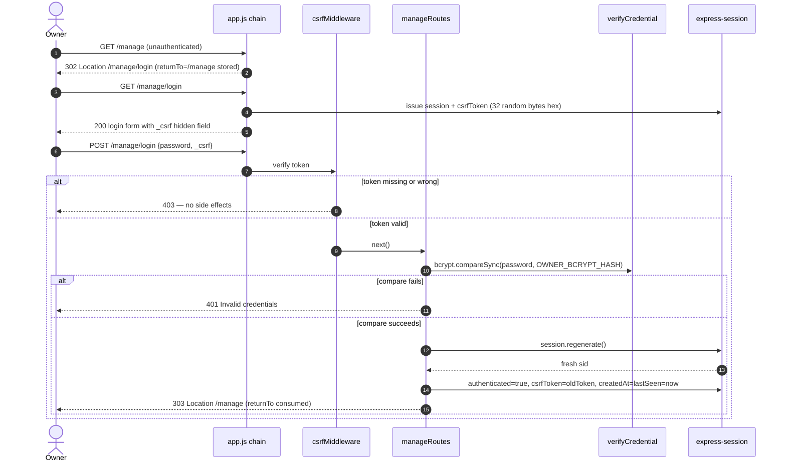

---

## D-SEQ-03 — Sequence: Create a project (validated write, UC-007)

**Teaches:** validation-precedes-write with values-preserving 400 re-render, and the Draft default. [EVIDENCED: `manageRoutes.js:132-148`, `projectRepository.js:23-30`]

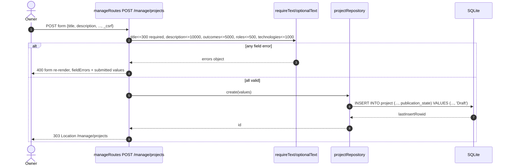

---

## D-SEQ-04 — Sequence: Publish → public visibility flip (UC-007/UC-001)

**Teaches:** publication is a single UPDATE; visibility is derived at read time, never copied. [EVIDENCED: `manageRoutes.js:186-198`, `projectRepository.js:13-16,49-53`; `tests/publication.test.js:12-51`]

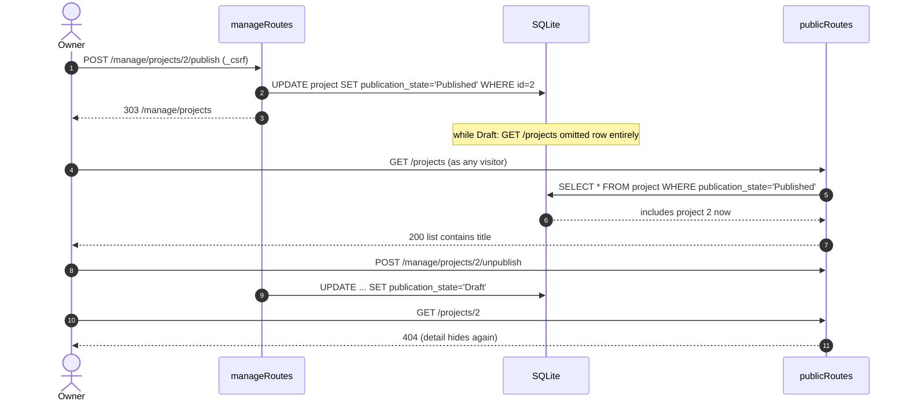

---

## D-SEQ-05 — Sequence: Link evidence to a claim + reverse traceability (UC-009/UC-010)

**Teaches:** idempotent link creation and the bidirectional queries that make FR-003 true. [EVIDENCED: `claimRepository.js:67-80`, `evidenceRepository.js:47-53`, `manageRoutes.js:383-392`]

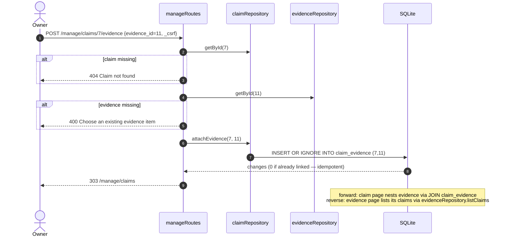

---

## D-SEQ-06 — Sequence: Security ordering contract (405 → 403 → 401)

**Teaches:** the frozen precedence that the test suite pins: method contract first, CSRF second, authentication third. [EVIDENCED: `app.js:85-95`, `csrf.js:19-30`, `auth.js:40-52`; `tests/auth.test.js:18-42`]

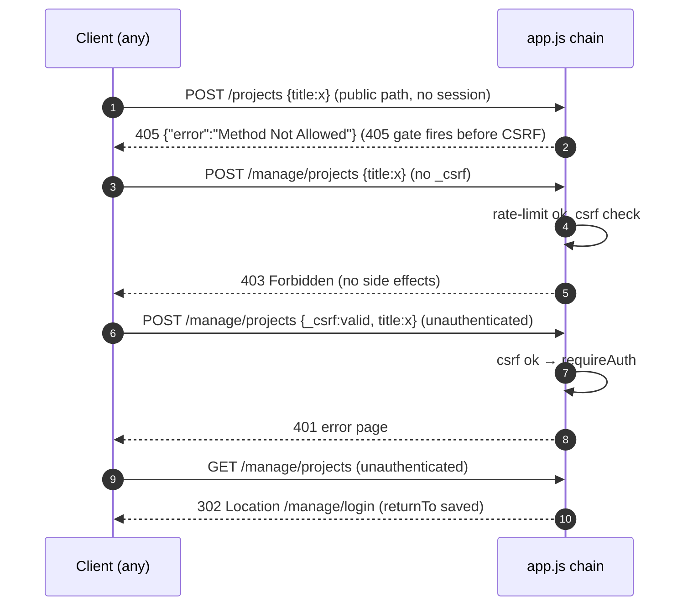

---

## D-SEQ-07 — Sequence: Health probe + graceful shutdown (UC-012/013)

**Teaches:** readiness is a real DB query, and shutdown closes the DB before exit with a 5 s force-exit. [EVIDENCED: `health.js:13-21`, `app.js:129-145`]

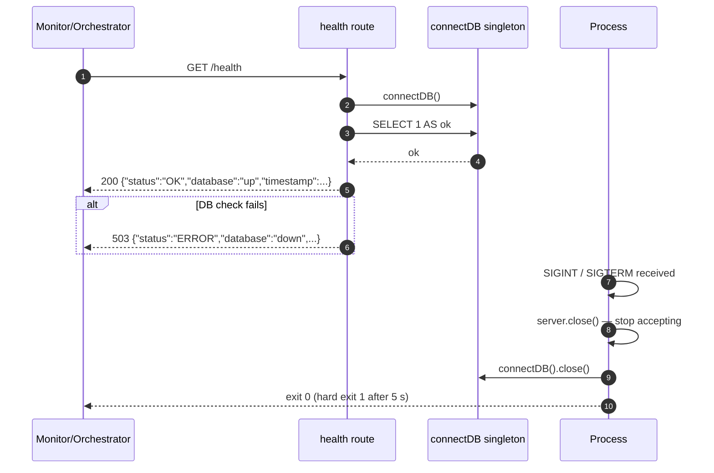

---

## D-SEQ-08 — Sequence: Preview a draft (UC-011)

**Teaches:** previews reuse the exact public templates but bypass the Published filter — the owner sees drafts without publishing. [EVIDENCED: `manageRoutes.js:447-470`]

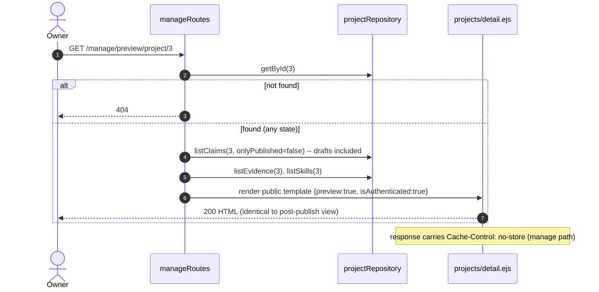

---

## D-COM-01 — Communication Diagram: Login collaboration

**Teaches:** the same flow as D-SEQ-02 seen as object links with numbered messages — useful when refactoring `auth.js` + `manageRoutes.js` together. [EVIDENCED: `manageRoutes.js:27-45`, `csrf.js`, `auth.js:55-63`]

```mermaid
flowchart LR
    O(["Owner browser"]) -- "1: GET /manage/login" --> SES["session<br/>(csrfToken)"]
    SES -- "2: 200 form + _csrf" --> O
    O -- "3: POST password + _csrf" --> CSRF["csrfMiddleware"]
    CSRF -- "4: token ok" --> MR["manageRoutes /login"]
    MR -- "5: compareSync" --> AUTH["verifyCredential<br/>(OWNER_BCRYPT_HASH)"]
    AUTH -- "6: true" --> REG["session.regenerate()"]
    REG -- "7: rebind csrfToken, set timestamps" --> SES
    SES -- "8: 303 /manage (returnTo)" --> O
    CSRF -. "403 invalid token" .-> O
    AUTH -. "401 wrong password" .-> O
```

---

## D-DEP-01 — Deployment Diagram

**Teaches:** what is actually deployed today vs the target declared in scope. Solid = exists; dashed = planned (BUILD_ROADMAP MODULE-009/010). [EVIDENCED: `package.json:5-11`, `database.js:26-35`, `app.js:46,67`; gap evidence: no `.github/`, no Dockerfile]

```mermaid
flowchart LR
    subgraph Client["«device» Client workstation/phone"]
        BR["Browser (visitor or owner)"]
    end

    subgraph Host["«node» Dev host (Windows) — as-is"]
        subgraph NodeP["«execution environment» Node.js 20+ process"]
            ART["«artifact» portfolio-system<br/>src/server.js + src/** + public/**"]
            SES["«artifact» MemoryStore sessions"]
        end
        ENV["«artifact» .env<br/>SESSION_SECRET, OWNER_BCRYPT_HASH, PORT, NODE_ENV, DB_PATH"]
        DB[("«artifact» data/dev.db<br/>SQLite WAL + schema.sql applied")]
        ART --- ENV
        ART --> DB
        ART --- SES
    end

    subgraph Target["«node» Container host — planned"]
        subgraph DK["«execution environment» Docker container (node:20-slim, USER node)"]
            ART2["«artifact» image: app + node_modules(omit=dev)"]
            VOL[("«artifact» volume /data/portfolio.db")]
        end
        CI["«node» GitHub Actions runner — planned<br/>npm ci → lint → test → audit"]
        ART2 --> VOL
    end

    BR -->|HTTP :3000 / HTTPS behind proxy later| NodeP
    BR -.->|HTTP| DK
    CI -.->|builds| DK
```

Deployment facts to respect: `secure` cookies and `trust proxy 1` activate only when `NODE_ENV=production` (`app.js:20,46,67`) — a production deployment must terminate TLS at a proxy or cookies will not send over HTTPS; sessions do not survive restarts (MemoryStore) so restarts are safe for data but force re-login.

---

## D-ERD-01 — ER Diagram (persistence view)

Self-contained copy of the data model view (narrative + field meanings in `SYSTEM_BLUEPRINT.md` §3). [EVIDENCED: `src/db/schema.sql`]

```mermaid
erDiagram
    profile ||--o{ experience : "profile_id CASCADE"
    profile ||--o{ education : "profile_id CASCADE"
    project ||--o{ project_skill : "CASCADE"
    skill  ||--o{ project_skill : "CASCADE"
    project ||--o{ project_evidence : "CASCADE"
    evidence ||--o{ project_evidence : "CASCADE"
    skill ||--o{ skill_evidence : "CASCADE"
    evidence ||--o{ skill_evidence : "CASCADE"
    claim ||--o{ claim_evidence : "CASCADE"
    evidence ||--o{ claim_evidence : "CASCADE"

    profile {
        int id PK
        string name
        string role
        string summary
        string contact_info
        string publication_state
        int singleton "UNIQUE=1"
    }
    project {
        int id PK
        string title
        string description
        string outcomes
        string roles
        string technologies
        string publication_state
    }
    skill {
        int id PK
        string name "unique ci, app-level"
        string description
        string publication_state
    }
    evidence {
        int id PK
        string description
        string file_path "http(s) URL"
        string file_type
        string accessibility_status
    }
    claim {
        int id PK
        string statement
        string justification
        string source_entity_type "profile|project|skill"
        int source_entity_id "no SQL FK - route-validated"
        string publication_state
    }
    experience {
        int id PK
        int profile_id FK
        string title
        string company
        string start_date
        string end_date
    }
    education {
        int id PK
        int profile_id FK
        string institution
        string degree
        string field_of_study
        string start_date
        string end_date
    }
```

---

## How to use this file

1. **Onboarding:** read D-UC-01 → D-CD-01 → D-ACT-01 in that order; that is actor → data → control flow.
2. **Before changing security code:** re-check D-ACT-01 and D-SEQ-06 — the ordering is test-locked and breaking it breaks `tests/auth.test.js`.
3. **Before any schema change:** D-CD-01 + D-ERD-01 are the source of truth for cascade semantics; pair the change with a migration (BUILD_ROADMAP MODULE-012).
4. **Before adding a page:** D-CD-02 shows the exact layer your route must sit in; D-SEQ-03 shows the validate-then-write pattern to copy.
5. **Diagram truth rule:** like all docs here, these diagrams can drift. The executables of truth are `npm test` (38/38 as of 2026-10-10) and `npm run lint`. Any code change that alters a flow shown here must update the diagram in the same PR (Engineering Checklist, `BUILD_ROADMAP.md` §5).
